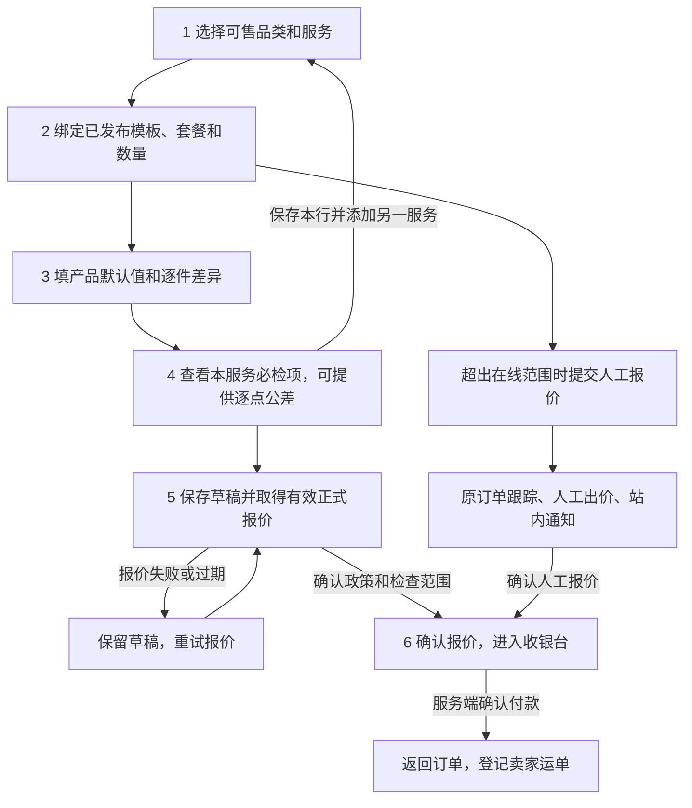

# My Workspace 客户中心整改报告

2026-11-11 至 2026-11-15 · 起始基线 `34d66aa` · 最新实现 `9975fd1` · 本地工程验收通过 · 外部验收 OPEN

本轮续接已有七个未提交文件中的客户工作台改动。原 `.env` 指向的开发库和测试库共用一个已经不存在的本地 socket。`.env` 保持原配置，验证使用本机 PostgreSQL 的独立数据库，分别执行空库关系校验、全量集成及 Chrome。目录、仓址、凭证、运单、图片、支付和角色账号均为隔离夹具。测试未触发外部实物操作或真实交易。

## 当前交付：逐件检查状态一致性

2026-11-15续审实际发现并复现了原指令§十、§17.1/17.4要求的状态缺口。实现`9975fd1`已修复，原业务状态机、质检作业、报告及收费历史均未修改。此前期限配置和所有专项保留在下文，最新常态矩阵已在本次实现重新完整运行。

根因：客户库存直接按整单状态统计和显示检查进度；仓库单件/包裹查询使用`task.assignment_id=assignment.id OR task.order_line_id=assignment.order_line_id`，把同一服务行的其他件任务也匹配进来。真实30件订单仅启动第一件后，第二件就被错误显示为`in_inspection`，定向断言退出1。不是缓存或文案问题。

现在标准件只关联本件有效assignment，比较及参考样组按真实group_members关联。一个共用SQL投影供客户库存、订单实物、仓库单件和包裹复用。客户列表与抽屉分别显示每件检查状态和整单状态，新增“Inspection complete”筛选及完成件数；待检统计排除已检查完成的件。任务已提交与报告已发布、可处置仍分别判断，不因某一件完成就自动开放检后处置。规格§7补充接口已同步，读取字段为追加兼容，无数据库迁移或新增权限。

| 验证 | 退出码 | 真实结果 |
| --- | --- | --- |
| 定向30件反例 | 1 | 未修复时第二件应pending，实际in_inspection，失败日志保留 |
| 修复后定向2项 | 0 | 30件逐件独立；部分提交后29待检/1完成，全部提交后0待检/30完成；报告发布后才进入待处置 |
| `npm run test:integration`（专用隔离库） | 0 | 66/66，0失败/跳过；扩展真实三件比较组成员阶段、原AUD-001–015、NEW-001–011及十类业务E2E |
| `npm run check` / `npm run build` | 0 / 0 | 类型与生产构建 |
| `python3 docs/contracts/check.py` | 0 | 49核心交易操作，补充读取规则同步规格，原契约不变 |
| 空库`docs/contracts/verify.sql` / 脚本语法 / 补丁检查 | 0 / 0 / 0 | 未播种已迁移空库关系断言及工程校验 |
| 完整`node tests/workspace.browser.mjs` | 0 | 当前实现33页面/状态×1440/1280/1024/768/390/375共198张；草稿、报价五类失败、实际恢复与隔离付款、库存、报告/PDF及客户/审核/质检隔离 |
| `QCW_BROWSER_ITEM_STAGE_ONLY=1 node tests/workspace.browser.mjs` | 0 | 同一真实30件任务由质检员提交；客户显示29待检/1完成、处置未提前开放，仓库单件及订单读取一致，另一客户404；六档24张 |

专项的首次浏览器提交被原证据独占守卫拒绝，原因是脚本给多个结果复用同一媒体记录；改为每项独立上传，没有放宽守卫。实际提交成功后，后续定位器同时命中筛选选项和列表标签，断言2而预期1；改为对应表格行定位，沿用同一已提交任务续验，保留此前六张“检查中”原图并补齐其余18张。未回滚任务或制造新状态来掩盖失败。浏览器日志如实记载续验，并非一次无中断专项。

实际查看375/1440px完成件列表、375px完成件抽屉原图，状态层次清晰，无按钮遮挡或整页横向溢出。最新[742张证据图集](/Users/jianouyang/.codex/visualizations/2026/11/11/01a1c9a2-fdf1-7a22-9910-efda30edbe7e/qcwarehouse-item-stage-delivery/index.html)由本次198常态、24逐件状态、前次18期限及502未受影响专项构成；各组保留实际实现与阶段。[SHA-256、命令及退出码清单](/Users/jianouyang/.codex/visualizations/2026/11/11/01a1c9a2-fdf1-7a22-9910-efda30edbe7e/qcwarehouse-item-stage-delivery/manifest.json)可核对原图、运行文件与失败日志。五个隔离运行副本68份app/packages文件一致，3000/3429/3430/3431/3432健康200；源库只读计数仍77订单/50包裹/134实物/12报告/91用户。

本次推进实际读取和客户操作完整性，不以重复状态报告代替整改。原七组剩余OPEN保持原责任及恢复条件；预检仍确认Stripe Test Mode、邮件、承运商未配置，真实实联与实仓证据不能写成已通过。

## 当前交付：后台报价期限与付款倒计时

用户在本轮确认“时效过期价格失效，包括已经打开收银台”，并要求期限可由后台配置。实现提交`77c9715`已落实此规则；没有把五秒到期测试夹具写成商业默认值。原专项的路由、页面矩阵、六步工作流、十类E2E和问题根因仍在下文，本节为最新结果。

入口：超级管理员访问`/admin/config`（兼容现有`/admin/settings`），首张“报价有效期”卡片。自动质检及范围补款、发运、续存可分别配置30–43200分钟，1440分钟即一天；近期10分钟员工MFA、服务端角色、CSRF、幂等键和配置版本冲突守卫均沿用现有机制。保留原默认自动质检30分钟、发运/续存72小时，未擅自替业务方选新默认。人工报价仍单独指定截止时间。配置只影响之后新生成的报价，旧报价、已提交收费和报告不改写。

| 行为 | 根因修复及验证 |
| --- | --- |
| 可配置有效期 | 原期限分别写死在质检、补款、发运、续存服务。现在共同读取原app_config的版本参数，实际三类新报价读取配置并存期限来源快照；修改前报价截止保持不变 |
| 客户倒计时 | Review、Payment Preview、原单付款、履约报价及范围补款显示剩余时间；原单付款在按钮上方同时显示绝对截止时刻。倒计时每秒变化，支付资格仍由服务端判断，过期不显示继续付款 |
| 已打开Stripe收银台到期 | 创建时提交Stripe支持的expires_at，并使用既有outbox在报价截止或会话截止主动调用expire。已有渠道会话由周期扫描补齐到期任务。失败有界重试并可从原后台任务页恢复；不是只隐藏门户按钮 |
| 创建丢响应及并发 | 先持久化本次完整渠道参数，再以原payment ID幂等创建。丢响应后重试保留相同expires_at与参数；并发只有同一付款尝试、渠道会话及到期任务，跨截止创建仍留存渠道引用以便关闭 |
| 延迟回调与真正迟到付款 | 按已验签支付成功事件时间对照原报价截止，截止前支付但回调晚到正常履约；截止后/无法确认时间的到账保留实际资金记录并生成唯一核对工单，不应用原收费、不生成待检实物、不自动退款 |
| 隔离与兼容 | 客户及仓库角色不能配置，近期MFA失效不能保存，双管理员并发保存一成功一409。Demo不可确认真实渠道尝试；服务端原报价/数量/模板/组织守卫、原状态枚举、AUD及NEW回归保持 |

Stripe托管Checkout原生会话期限为创建后30分钟至24小时。剩余报价不足30分钟时由到期任务主动关闭；报价长于24小时则支付会话可能先到期，在报价仍有效时可安全重开。渠道不可用时保留关闭失败并重试，不能保证网络中断时远端画面恰在同一毫秒切换；因此服务端迟到款守卫同时生效。Stripe官方明确已expire会话不能继续完成付款，但没有可据此保证每个托管页面都显示本系统自定义倒计时的接口；本系统已提供动态倒计时，并向Stripe提交绝对截止提示。[创建会话](https://docs.stripe.com/api/checkout/sessions/create) · [关闭会话](https://docs.stripe.com/api/checkout/sessions/expire)

| 最新验证命令 | 退出码 | 实测结果 |
| --- | --- | --- |
| `npm run check` / `npm run build` | 0 / 0 | 类型及生产构建通过，含最终期限布局 |
| `python3 docs/contracts/check.py` | 0 | 49个交易操作，174 TASK、69 PAGE、111 T、46 AT |
| `TEST_DATABASE_URL=postgresql://127.0.0.1/qcw_test-workspace-parcel-pages npm run test:integration` | 0 | 66/66，0失败/跳过；含配置并发、渠道丢响应及关闭重试、两类到账时间、回调幂等和原十类E2E |
| `psql -X -h 127.0.0.1 -d qcw_test-workspace-continuation-relations -v ON_ERROR_STOP=1 -f docs/contracts/verify.sql` | 0 | 已迁移未播种空库关系断言，事务回滚 |
| `node tests/workspace.browser.mjs` | 0 | 完整33页面/状态×六档198张，草稿中断/恢复、五类报价失败与真实恢复、隔离付款、库存操作、报告/PDF及客户/审核/质检隔离 |
| `QCW_BROWSER_QUOTE_POLICY_ONLY=1 node tests/workspace.browser.mjs` | 0 | 管理配置/客户倒计时/真实过期阻断共18张；最终期限位置与手机布局补验通过 |
| `node --check tests/workspace.browser.mjs` / `git diff --check` | 0 / 0 | 脚本语法与补丁通过 |
| `npm run integrations:check`（隔离历史副本） | 0 | 如实显示Stripe、邮件、承运商均未配置，未冒充真实渠道通过 |

Chrome运行于`http://localhost:3431`及`qcw_test-workspace-quote-policy-browser`。配置专项实际将自动报价设为一天、续存一周，通过API和数据库核对后恢复原值；五秒边界仅在接受前缩短独立测试报价，没有改变全局默认或历史收费。完整198张采集后仅调整Step 6说明及原单付款截止时刻位置；最新18张补验原单期限位置，Step 6说明由最终类型/构建验证，不把此前文案原图冒充最终UI。所有原图无整页横向溢出；实际查看375px管理长页、375/1440px付款及375px过期原图。初次管理头部在768/390/375、后续1024px溢出的失败记录保留，修复仅限原管理头部换行。

最新[718张原图、日志与图集](/Users/jianouyang/.codex/visualizations/2026/11/11/01a1c9a2-fdf1-7a22-9910-efda30edbe7e/qcwarehouse-quote-policy-delivery/index.html)包含新198张常态和18张期限专项，以及未受影响的前期502张专项；各组注明实际实现版本与采集阶段。[命令和SHA-256清单](/Users/jianouyang/.codex/visualizations/2026/11/11/01a1c9a2-fdf1-7a22-9910-efda30edbe7e/qcwarehouse-quote-policy-delivery/manifest.json)记录退出码、反例及运行副本核对。四个运行副本67份app/packages文件逐一一致，3000/3429/3430/3431健康200；源库只读复核仍为77订单、50包裹、134实物、12报告和91用户，`.env`不变。

OPEN-03的用户业务决定及本地工程已落实；真实Stripe Test Mode的实际expire、托管页面和收据验证并入OPEN-02继续OPEN。其余正式发布输入、实仓、照片发布、兼容性和原文允许记录的条件性后端缺口仍逐项保留，不能声明所有生产验收均已完成。

## 前次交付与支持闭环续验

本次从`756b540`继续实际审查并修复了支付拒绝与支持写入的遗漏，没有以既有OPEN记录代替可执行的代码修复。实现提交为`2f55cd7`、`c2c71a4`、`5273e24`、`9b7e503`。最新完整报告、日志、原图及清单入口为[最终图集](/Users/jianouyang/.codex/visualizations/2026/11/11/01a1c9a2-fdf1-7a22-9910-efda30edbe7e/qcwarehouse-completion-final/index.html)和[SHA-256及命令清单](/Users/jianouyang/.codex/visualizations/2026/11/11/01a1c9a2-fdf1-7a22-9910-efda30edbe7e/qcwarehouse-completion-final/manifest.json)。后文保留前次验收与各次反例，不将历史版本或失败记录改写为当前通过。

| 本次发现 | 根因及最终行为 | 实际验证 |
| --- | --- | --- |
| 错误金额回调重复生成客户工单 | 原分支在主事务外写工单，然后409回滚事件去重记录。改为事件、唯一工单与拒绝审计同事务提交，再由路由返回原409；重复事件复用原拒绝结果 | 修改前首次加三次并发重投得到4张工单，断言失败。修改后首次加15次并发重投仍只有1张工单、1条拒绝审计和1条已处理事件；订单待付款、收费未应用，其他客户404 |
| 开单或回复已保存，但丢响应后重复提交 | 原表单重试生成新请求键。四类客户表单显式保持同一字段和附件的尝试键，成功或输入改变后开始新尝试；即时重入守卫保留 | Chrome等待实际服务端200/201后丢弃响应，再以原键重放。开单只有原工单、照片回复只有原消息和原附件；成功后相同内容可作为新操作发送；422后修改输入使用新键 |
| 包裹认领与理赔决定丢响应后恢复不清楚 | 同样复用已有服务端幂等契约，未更改权限、审批或决定规则 | 认领上传证明后重放201并保持原工单，客服审核后仓库归属、通知和实收读取通过。理赔决定重放200，决定与实际赔付款确认分开，仍需独立审批 |
| 已保存的开单/认领仍显示空列表 | 原成功回调之外不刷新列表。现在写入结束后读取权威记录，未知响应不再让已存在对象停留在空列表 | 丢响应后、重试前即等待原工单/认领链接在实际页面出现；跨客户仍不可读取 |
| 原生网络报错与校验技术文案 | 在原传输层规范网络失败，保留Abort及上传有界重试；保持原草稿连接提示。支持输入schema使用可理解的原字符限制说明 | 原草稿恢复断言不变；支持错误原图显示连接中断、请求可能已保存和安全重试说明，422明确150字符限制 |
| 第二次提交失败仍残留上一单成功提示 | 成功提示与表单重置键分离，新提交清除旧提示，只有真实成功才重置表单 | 422时无旧“Case opened”成功提示，字段、附件和失败尝试键仍保留，后续修正可提交 |

上述资金修复没有新增状态或迁移，没有调整金额、价格快照、报价有效期、晚到款政策、SLA、权限或历史报告。异常事件的留证方式同步到规格C.3，原HTTP错误代码与409保持。未删除或合并任何历史工单。

| 最终验证 | 退出码 | 结果与范围 |
| --- | --- | --- |
| `npm run check` / `npm run build` | 0 / 0 | 最新实现`9b7e503`类型与生产构建 |
| `python3 docs/contracts/check.py` | 0 | 47交易操作、174 TASK、69 PAGE、111 T、46 AT |
| `TEST_DATABASE_URL=postgresql://127.0.0.1/qcw_test-workspace-parcel-pages npm run test:integration` | 0 | 最新实现64/64，0失败、0跳过；含15并发拒绝重投和原AUD/NEW、十类E2E |
| `psql -X -h 127.0.0.1 -d qcw_test-workspace-continuation-relations -v ON_ERROR_STOP=1 -f docs/contracts/verify.sql` | 0 | 同一未变更SQL基线的空库关系断言，事务回滚 |
| `node tests/workspace.browser.mjs` | 0 | `c2c71a4`完整一次通过，33页面/状态×六档198张，草稿/报价/付款/库存/报告/PDF及客户、审核、质检隔离 |
| `QCW_BROWSER_SUPPORT_ONLY=1 node tests/workspace.browser.mjs` | 0 | 最新`9b7e503`开单、照片回复、422、更改输入、原键重放、新尝试与成功提示；六档24张 |
| `QCW_BROWSER_INTAKE_CLAIM_ONLY=1 node tests/workspace.browser.mjs` | 0 | `2f55cd7`证明上传丢响应、原键重放、客服/仓库/通知闭环；六档42张 |
| `QCW_BROWSER_INCIDENT_ONLY=1 node tests/workspace.browser.mjs` | 0 | `2f55cd7`独立审批、决定丢响应重放与分离的赔付确认；六档36张，不代表实际银行转账 |
| `QCW_BROWSER_PAYMENT_MISMATCH_ONLY=1 node tests/workspace.browser.mjs` | 0 | `2f55cd7`由真实已签名回调处理产生的唯一工单，在本人列表与详情可见，另一客户404；六档12张 |

Chrome使用`http://localhost:3430`、`qcw_test-workspace-callback-browser`和manifest所列隔离客户。该库从完整隔离集成结果复制，没有伪造客户工单来替代回调证明。全页矩阵之后只修改支持字段提示和连续提交反馈，已由最新支持专项补验，未将旧图片冒充最新HEAD截图。新增恢复专项114张；以最新198张常态矩阵替代旧常态图后，连同未受影响的前期专项汇总700张，全部文件与SHA-256可核对，整页横向溢出均为0。已实际查看最新六档总览、手机错误/恢复原图及前述独立视觉证据，未宣称700张逐像素独立复核。

失败日志保留：首次回调去重4对1反例、支持重试请求键变化、等待定位器误命中空播报节点、旧实例退出、历史库存夹具被真实处置消耗，以及草稿连接文案兼容性失败。没有跳过跨页断言或删除失败记录。固定版本完整Chrome和四类专项最终均退出0。

3000、3429、3430运行副本的65份受跟踪源文件均与最新实现逐一相同。原3000/3429进程退出后已确认端口无监听并恢复原副本，3000使用独立会话进程维持网站运行；健康检查均200。源库只读复核仍为77订单、50包裹、134实物、12报告、91用户。网站使用历史验证副本，原库及`.env`不变。

原指令的11项交付仍由下文对应表、路由矩阵、工作流图、十类E2E和状态联动记录承载；本次新证据补入同一报告。OPEN-01–08仍保持原状态与恢复条件，不能以本地工程通过代替正式规则批准、真实渠道或实仓签收。

## 最终整包验收

本节保留前次`a2f2b2e`整包验收记录，最新结论与图集以“当前交付：逐件检查状态一致性”为准。2026-11-14 已对 `a2f2b2e9a24ba9a86c96dbf4546b33926978f0ab` 执行完整工程门禁及一次完整 Chrome 回归。后文保留各次发现、失败诊断、修复与专项验收的历史记录。未具备外部接入或业务决定的事项仍按原指令保留 OPEN，不作为生产开放批准。

最终证据入口：[截图、日志与筛选图集](/Users/jianouyang/.codex/visualizations/2026/11/11/01a1c9a2-fdf1-7a22-9910-efda30edbe7e/qcwarehouse-final-acceptance/index.html)；[命令、退出码、源文件与截图 SHA-256 清单](/Users/jianouyang/.codex/visualizations/2026/11/11/01a1c9a2-fdf1-7a22-9910-efda30edbe7e/qcwarehouse-final-acceptance/manifest.json)。图集内附本报告副本和六份最终日志。

| 最终命令 | 退出码 | 结果 |
| --- | --- | --- |
| `npm run check` | 0 | TypeScript 通过 |
| `npm run build` | 0 | Next.js 16.4.5 生产构建通过 |
| `python3 docs/contracts/check.py` | 0 | 174 TASK、69 PAGE、111 T、46 AT、47交易操作 |
| `TEST_DATABASE_URL=postgresql://127.0.0.1/qcw_test-workspace-parcel-pages npm run test:integration` | 0 | 64/64；0失败、0跳过，AUD、NEW及十类E2E保持 |
| `psql -X -h 127.0.0.1 -d qcw_test-workspace-continuation-relations -v ON_ERROR_STOP=1 -f docs/contracts/verify.sql` | 0 | 已迁移未播种空库关系断言，BEGIN / DO / ROLLBACK |
| `node tests/workspace.browser.mjs`（未设置专项或恢复运行开关） | 0 | 完整一次通过：草稿丢响应重放、离线刷新、双标签冲突、新客户空态、五类报价故障及真实恢复、支付重放、跨页实物处置、客户/审核/质检角色与报告/PDF隔离 |

最终 Chrome 使用 `http://localhost:3429`、独立库 `qcw_test-workspace-parcel-receipt-browser` 和本机 Playwright。完整环境参数见 manifest 的 `browser_environment`，其中均为隔离测试客户，不含凭证。当前实现共33页面/状态，1440、1280、1024、768、390、375px各33张，共198张。另汇总多服务范围12张、206待办6张、24入口主要读取96张、辅助读取174张、媒体恢复52张、确认样/对比报告12张、发运恢复36张，总计586张原图；每个专项保留各自实现版本，未将旧截图冒充最终HEAD重新拍摄。全部记录对应实际PNG文件，整页横向溢出均为0。

实际视觉复核包括最终六档总览、1440/375px长页面下半部，以及前文独立审查与原图细看。已修复独立审查发现的窄屏对比表词中拆行，未仅凭溢出断言判定视觉通过。586张是证据文件数量，并非逐像素独立审查数量。

预览3000和浏览器3429的65份受跟踪运行源文件逐一SHA-256对照当前实现一致；临时副本仅另有依赖根配置。两个实例 `GET /api/v1/health` 均200。源库最后一次只读计数仍为77订单、50包裹、134实物、12报告、91用户。集成测试只在专用隔离库重建，不操作源库。网站入口为 [本机预览](http://localhost:3000/)。

### 原指令交付逐项对应

| 原指令最终交付项 | 本报告及实际证据 |
| --- | --- |
| 1 全部页面与真实路由 | “实际路由与页面审查”，包含主页面、原单子页、独立详情、兼容路径及深链 |
| 2 逐页面功能矩阵 | 同上，以及“客户页面状态矩阵”；主要读取24入口、辅助读取14类分别验收 |
| 3 缺失功能、错误行为、UX问题 | “根因与变更”、各续审实测反例；未闭环项集中编号OPEN-01–08 |
| 4 六步实际工作流 | “六步工作流”Mermaid及目录→草稿→报价→付款→原单寄样说明 |
| 5 导航、按钮、模板、报价根因 | “根因与变更”，明确创建DTO字段、实际POST报价路由、模板条件与原15mm来源 |
| 6 修复代码、测试及证据 | Git实现提交及本节命令；`tests/workspace.browser.mjs`和隔离集成断言；各专项图集保留初次失败与恢复日志 |
| 7 桌面和移动截图 | 最新常态33页面/状态×六档198张；支持、认领、理赔和拒绝回调专项114张；连同前期专项按版本汇总700张可筛选图集 |
| 8 数据及状态联动 | “数据与状态联动”、历史数据核验、真实批次恢复与仓库队列、目录/模板/报价/任务/报告断言 |
| 9 十类E2E结果 | “十类端到端回归”逐条列出通过范围，区分真实数据库/API、Chrome故障注入及未发生的实体交接 |
| 10 无法修复与业务决定 | “当前完成度核实”七组剩余记录及已落实OPEN-03及“OPEN与NEEDS_BUSINESS_DECISION”责任、恢复条件；无假按钮或擅自政策变更 |
| 11 Commit、命令、退出码、回归 | 最新实现`9b7e503`及本节保留的历史提交；最新门禁和专项均0，详细失败诊断保留；本报告记录提交可用`git log -1 -- docs/My-Workspace整改报告.md`取得 |

原指令第二至四章的导航、六步和单一摘要对应前述向导及范围/恢复专项；第五至十四章对应逐页矩阵；第十五、十七章对应十类E2E、状态联动及隔离断言；第十六、十八、十九章对应六档Chrome、独立视觉复核与完整工程门禁；第二十章对应以上11项交付及下表12条完成标准。CSV和语言/通知偏好按原文条件性范围评估，未扩展为未经批准的新接口或存储模型。

## 当前完成度核实

2026-11-14 续验结论：原指令十二条完成标准均已有本地数据库、接口及 Chrome 证据，整体生产验收尚未签收。审查基线 `956f64d` 发现的五项代码缺陷和一项证据缺口已消除。后续发现的发运确认中断恢复问题也已修复并通过真实批次及仓库队列断言。对`4ecb37e`续审又发现辅助请求覆盖遗漏，本轮已修复并增加14类辅助请求故障回归。具体覆盖和新增缺口按各续审子节记录，不以已有证据推断未检查的状态已经通过。

剩余台账共有 **7组未闭环记录**，分为2组上线输入或外部验收、2组业务/兼容性决定、3组条件性后端缺口。OPEN-03已按用户最新确认实现，其实际Stripe沙盒验证归OPEN-02。以下按问题组计数，不把同一问题在多个页面重复计数，也不将条件性审查项追加成本轮必须自行实现的新业务。

| 编号 | 类型与状态 | 未闭环内容 | 与原指令的关系及恢复条件 |
| --- | --- | --- | --- |
| OPEN-01 | 上线输入 · NEEDS_BUSINESS_DECISION | 正式仓址、法律文本、可售目录/套餐和数量档交期审批 | 保留原有效规则，演示配置有明确隔离。业务方在原TASK确认发布输入后验收正式开放；本轮未擅改价格、SLA或发布状态 |
| OPEN-02 | 外部验收 · OPEN | Stripe Test Mode交易和托管收据、邮件/承运商实联及实仓设备验证 | 当前配置预检均未启用，实际供应商与实仓不得写为通过。现有隔离适配器、签名事件和真实数据库证明工程链路，真实渠道及实体作业由原负责人配置测试接入后续验 |
| OPEN-03 | 用户已确认 · 本地工程通过 | 后台可配置期限，过期关闭已打开会话，真正迟到款人工核对 | `77c9715`落实，66/66及六档Chrome通过。真实Stripe沙盒证据归OPEN-02，未将其关闭 |
| OPEN-04 | 业务决定 · NEEDS_BUSINESS_DECISION | 原始外箱照片的裁剪、复核和对客发布规则 | 客户可看本人包裹的实收记录和结构化外箱异常，原始入库照片沿用既有媒体权限。规则确认后按原权限契约实施发布 |
| OPEN-05 | 兼容性决定 · NEEDS_BUSINESS_DECISION | 受NEW回归保护的旧确认样接口精确库位字段是否停发 | 新库存和实物抽屉已裁剪客户字段。旧字段变更须协调契约和受保护调用方；此项是兼容性审查记录 |
| OPEN-06 | 条件性后端缺口 · OPEN | 客户自行关闭或重开工单 | 已有创建、列表、详情、客户/员工回复与客服结案。本轮按原文“后端尚未支持则记录缺口”交付，新增权限和关联业务限制待决定 |
| OPEN-07 | 条件性后端缺口 · OPEN | 未委托包裹独立申报供应商和预计件数 | 已关联订单可从逐件申报读取供应商和预计件数。独立字段无现成存储契约，需在原TASK批准结构与迁移后实现 |
| OPEN-08 | 条件性后端缺口 · OPEN | 客户语言与通知偏好设置 | 原文限定“若已有支持”。现有昵称与时区可保存，尚无对应偏好工作流，已记录缺口，未添加无效控件 |

本机原数据库已核实，不属于剩余阻塞。剩余七组记录不能相加为七个本轮强制编码缺陷。原文允许保留的缺口和业务决定继续保持OPEN；本地工程证据、实际供应商联调及生产开放分别签收。

| 原完成标准 | 当前本地证据 |
| --- | --- |
| New Inspection没有重复导航 | 主侧栏与唯一六步进度，六档Chrome |
| 六步表单完整走通 | 新客户真实草稿、报价、隔离付款、原单寄样；多服务行可往返编辑 |
| 模板和商品对应 | 子类/模板版本、检查范围、仓库任务及报告关联断言 |
| 正式报价接口及目录金额一致 | 真实报价201与隔离有效目录版本、逐行金额、有效期及失败阻断 |
| 订单摘要不重复 | 唯一实例，单行和多行字段同步，六档截图 |
| 草稿保存和恢复 | 服务端回读、清空覆盖值、小数公差、刷新、离线与两标签页冲突 |
| 每个模块有真实入口 | 下文实际路由清单与逐页审查矩阵 |
| 关键操作反馈和异常处理 | 24入口主要读取、14类辅助读取的加载/503/真实重试，报价及发运中断恢复，四类客户支持写入的丢响应原键重放和真实状态回读 |
| 数据库与前端一致 | 逐件记录、报价/账单、包裹、报告、待办及原批次状态回读 |
| 客户数据隔离 | 两客户读取/写入、私有媒体/PDF、通知/工单与仓库角色权限断言 |
| 桌面和移动端布局 | 最新常态33页面/状态六档198张；连同各专项共742张，含逐件任务阶段、加载、错误、恢复与窄屏原图复核，各自注明实现版本 |
| 客户与仓库衔接 | 十类隔离E2E及审核/质检角色回归，发运恢复进入真实待称重队列 |

当前证据分层：六档常态矩阵已在实现 `9975fd1` 完整重跑；逐件状态专项24张补验，期限及支持恢复等未受影响专项保留各自实际版本。发运、辅助读取、共享抽屉、证据图片及四类支持写入分别保留专项版本。Stripe适配器夹具不等于实际Stripe Test Mode交易，实仓动作由隔离角色调用真实领域接口验证，未宣称已实际出库。

## 实际路由与页面审查

| 模块 | 代码确认的客户入口 | 实际数据与操作 | 验收边界 |
| --- | --- | --- | --- |
| 工作台 | `/account` | PostgreSQL 汇总未结订单、包裹入仓、待处置实物和待确认报价。显示最多三项实际待办、当前默认仓址、永久码、最近订单和五条活动 | 已生效的默认仓址切换为旧账户显示审计时间和新地址提示。真实业务仓址 OPEN |
| 下单 | `/orders/new`，支持 `offer` 和 `draft` 深链 | 主侧栏、单一六步进度、单一摘要。目录联动、已发布模板、逐件默认值与覆盖、草稿与真实报价 | 正式数量档交期、线上未发布组合、未配置附加检查 OPEN |
| 订单列表 | `/orders` | 服务端按订单号、状态、页码查询。按最新记录排序，显示逐件数量、质检状态、付款、报告及下一步。浏览器后退恢复筛选 | 以订单级状态汇总，逐件状态在详情 |
| 订单详情 | `/orders/{publicNo}`，子页 `/payment`、`/parcels`、`/dispositions`、`/storage` | 展示创建、付款、到齐、报告发布、结案等已记录时间。原单支付恢复、实际到仓、范围、售后和逐件处置 | 暂停及异常按实际工单和状态展示，特定短少恢复见 E2E-04 |
| 订单履约详情 | `/orders/{publicNo}/quotes/{id}`、`/orders/{publicNo}/shipments/{id}`、`/orders/{publicNo}/cases/{id}` | 报价版本、仓库交接、运单和工单使用原单与对象双重约束。已交接出库可从 `/shipments/{id}` 直接查看，包括无质检订单的发运 | 有效正式运输价格及提供方联调 OPEN |
| 待办 | `/actions` | 草稿、待支付、卖家追踪、人工报价确认与过期续询、待选处置、物流验证、范围修订、参考样、续存及客户待回复工单有深链 | 泛化暂停不再单独计作客户待办。人工收件归属审核期间不暴露未匹配仓库对象 |
| 报告 | `/reports`、`/orders/{publicNo}/report`、`/orders/{publicNo}/report/versions/{n}` | 默认最新已发布，支持精确检索和查看历史。PDF 请求锁定同一版本。报告实物编号直达客户库存 | 公开分享沿用原开关，发布快照和私有证据隔离保留 |
| 包裹 | `/parcels`、`/parcels?tab=attention`、`/parcels/{id}`、`/shipments/{id}` | 登记运单、绑定本人订单、入仓与承运商状态分列、认领指定运单、出库追踪。待核验申请可分页查看，支持补充回复和结果通知。归属核实后可从原工单打开包裹，查看仓库登记时间、件数和外箱状况 | 通过已关联订单的逐件运单读取供应商和预计件数，与仓库记录数量分列。独立包裹的供应商和件数申报、原始外箱照发布规则 OPEN |
| 实物 | `/items`，实物使用 `?item={code}` 打开抽屉，兼容 `#item-{code}` | 实物编号、所属委托、检查与保管状态。逐件显示实际任务阶段，检查完成与整单报告状态分开，支持待检及已检查筛选。按实物提交不同去向，支持退商家、集运、续存和确认样。待封存状态独立展示 | 每页 20 件，统计与筛选来自全部本人库存。选择跨页保留，提交后回读真实逐件指令 |
| 账单 | `/account/billing`，兼容 `/billing`，用 `?charge={id}` 定位具体收费 | 分开待确认报价、收费和退款。按入账或报价接受时间展示，区分测试付款。订单、待办或通知可直接定位本人历史收费。退货、发运和续存收费显示其关联订单 | Stripe 沙盒及正式主体收据验收 OPEN |
| 通知 | `/account/notifications`，兼容 `/notifications` | 所属对象深链、关联工单或运单编号、已读写回、未读计数、游标分页。付款、入库、报告和封存使用现有事件去重键 | 邮件与实际承运商事件联调 OPEN |
| 支持 | `/support`、`/support/cases/{id}` | 创建工单、按工单号或订单号查找、按状态筛选并分页。旧工单有公开回复时排到前面，详情支持公开对话、客户回复及证据附件 | 可从本人包裹进入工单，创建时附照片，客户与授权客服可查看。客户自行关闭或重新开启 NEEDS_BUSINESS_DECISION |
| 账户安全 | `/account/security` | 邮箱、登录方式、设备、敏感操作重新认证、导出与账户关闭。永久码显示于账户与安全页面 | 可编辑昵称与显示时区，服务端验证并应用于工作台日期。语言与通知偏好未有对应设置工作流 |
| 测试收银台 | `/checkout/demo/{id}` | 隔离模式确认真实数据库收费记录。付款后回到原检验订单。客户隔离与重复确认由服务端验证 | Stripe 沙盒及正式验收 OPEN |

公开恢复入口为 `/account/recovery`，登录、注册和 onboarding 沿用现有路由。外部分享 `/r/{token}` 不列入客户主导航。路由清单来自 `packages/core/portal-routes.ts` 与 `app/portal.tsx`。

## 六步工作流

报价快照锁定订单行、Offer、SKU 价格版本、模板版本、数量、金额、币种和有效期。交期使用对应目录规则和正式报价明细，并在实物到齐、已识别后按既有营业日规则计时。改动已审阅的内容会使界面不再显示旧报价，重复请求使用幂等键。向导在合法输入后自动保存，步骤切换、手动保存和带草稿号刷新均访问服务端草稿。逐件位置在付款后独立生成，填写运单没有仓库实收效力。

## 根因与变更

| 问题 | 可复核证据 | 整改 |
| --- | --- | --- |
| 404 后停在报价计算 | HEAD 创建草稿得到 `id`，向导读取了 `created.order_id`，随后 GET `/api/v1/orders/undefined`。真正报价为 `POST /api/v1/orders/{id}/quotes`，接收 `revision`，需客户会话、同源 CSRF 及幂等键，成功返回 201。编辑时备注字段亦与 OpenAPI 有差异 | 从创建或编辑 DTO 直接取得 ID 和 revision，省去中间 GET。新建省略空备注，PATCH 支持保留和清空。报价超时、HTTP 错误和过期分别反馈，Retry 继续同一草稿。正式报价失败的 Review 不展示旧估价 |
| 服装检查点混用 | 通用演示模板保存基础项目及带 `applies_if` 的专项点。历史客户端直接列 Offer 内容，显示范围没有复用仓库条件。专项 Offer 和三件通用对比的数量条件也不同 | 依据已发布模板元数据绑定，不以 SKU 字符串推断模板。预览与仓库复用条件规则。草稿可附带已审阅模板版本，旧版冲突和专项品类不符被服务器拒绝 |
| 15 mm 自动公差 | HEAD 把输入初始为 15，保存为 `tolerances.dimension_mm`。报告判定读取带检查点、最小值、最大值和单位的数组。旧字段并未提供有效逐点判定 | 默认只记录实测。逐点填写目标值和公差，单位沿用模板。已发布报告和历史订单原值不变 |
| 服务卡最低价 | 视觉复验发现第一步从目录取最低单价后直接展示为每件价格。默认已选模板的单价可能更高，摘要据此计算 | 有不同有效单价时显示 `From`。套餐根据有效报价显示固定价或区间，未开放服务标为不可用。摘要仍按当前模板与数量估算 |
| 双六步导航和摘要操作拥挤 | HEAD 同时有 New Inspection 专属侧栏和正文进度组件。HEAD 源码可确认摘要、页头、报价区存在重叠操作语义。历史截图的第二份摘要实例没有独立部署证据 | 删除向导侧栏及跨组件步骤事件。统一步骤编号，保留唯一摘要与保存入口，重置需确认。Chrome 断言唯一进度和摘要 |
| 共享页头和窄表格 | 初次 Chrome 矩阵测到演示页头把退出按钮挤出视口，通知和账单内容在手机出现严重断词 | 调整客户页头断点，保留账户退出和移动导航。客户密集表格以字段卡片显示。报告比较表保留可横向滚动的列 |
| 出库批次运单入口失效 | 客户批次读取返回运单字符串和扁平报价字段，组件将其当成带 ID 的对象和嵌套报价。Chrome 暴露出缺失 React key，按钮也拿不到运单对象 | 服务端增加已交接运单 ID 与号码，保留原字段兼容。列表用正确的报价字段，运单打开真实客户物流详情 |
| 确认短少后无法恢复 | 库存短少写入 `quantity_discrepancy`，原恢复接口只清除员工暂停。仓库候选和绑定也排除了短少暂停单 | 只对等待收货时因短少冻结的订单开放补件核验绑定。相关短少工单结案、所有范围内实物已经识别且其他冻结已解除后，员工可在原恢复入口排队。保留审计记录，范围、数量和原收费快照不变 |

| 续做事项 | 根因与修复 | 证据 |
| --- | --- | --- |
| 浏览器中断 | 原实现只恢复已成功写入的内容。当前标签页按客户和草稿暂存输入，服务端写入仍使用原草稿版本和幂等守卫。创建响应丢失后先重放原请求，再把后续编辑写到同一草稿 | Chrome 断网刷新、真实创建丢响应、两标签页竞争及数据库唯一草稿断言 |
| 账单收据 | 账单原来仅有处理商引用。新增按收费项读取的会话鉴权入口，逐笔核对入账、组织、付款与渠道对象。正式链接按需读取 | 已签名测试回调写入数据库，隔离渠道响应验证正常链接、错误组织/金额/URL 和跨租户、未付款访问 |
| 账单日期与原单定位 | 原列表按随机收费 ID 截取最近 200 条，旧通知可能找不到相应账目。现按业务日期倒序，指定收费仅在本人记录内优先读取。续存从报价接受时的实物关联查找原订单，退款沿用收费原单 | 用 205 条历史收费核对顺序、旧链接与另一客户的不可见性；在 Chrome 核对从付款页跳转和准确焦点 |
| 窄屏卡片文字 | 375 px 实拍发现付款状态和长实物编号在卡片内被截断，即使整页宽度正常。客户状态和编号现在可在各自单元格内换行 | 复核 375 px 原图；Chrome 在移动截图同时检查状态和编号的文本边界，比较报告保留可滚动对照表 |
| 大批量实物 | 原列表以已加载记录计算数量并截断。按本人库存分页查询并计算总量，以实物码授权打开报告关联物品 | 30 件跨两页分布、状态过滤、确认样及跨租户隔离。Chrome 两页选择提交真实续存指令 |
| 客户支持 | 原包裹和工单分开，首条消息无法提交证据。工单现在可带已授权入库运单和首条私有照片 | Chrome 从真实包裹提单与查看关联，真实工单/照片数据库记录和跨租户拦截 |
| 工单历史 | 原列表只读取最近创建的 100 条，旧工单的新回复可能被遗漏。客户列表现按客户可见更新排序，可按状态和工单号或订单号查找，每页 20 条 | 隔离库验证 101 条分页、相同时间稳定排序、旧工单公开回复后前移、内部备注不改变排序及跨客户不可见。Chrome 验证翻页、详情、返回和筛选 |
| 资料和地址 | 显示时区原来无写入端。客户设置持久化到现有用户字段，登录方式、邮箱和接收码照常使用。地址提示由真正的默认地址变更审计产生 | Chrome 保存与重开资料、订单日期显示。数据库核验过往包裹地址快照、换址、重复设置和新注册账户 |
| 人工报价续询 | 原报价过期后旧申请仍挡住续询，超量订单接受报价后也不能用自动报价恢复。现可在原草稿或未付款原单续询，待办、账单、员工队列和通知按当前可用报价更新 | 隔离数据库核对过期、处理中付款守卫、旧收费金额留档及替换、跨客户隔离。Chrome 验证续询到同单付款 |
| 运费与续存重报 | 已接受的履约报价过期后，客户详情仍提供付款，仓管也不能在原对象续报。现由原发运队列或续存队列重新出具版本，旧收费保留历史。渠道会话未决时继续等待核对，账单及待办只提供有效报价，续存出价有站内通知 | 隔离数据库核对签名会话到期、重复与迟到款对账、报价通知去重及一次续存入账；Chrome 验证仓管出价和客户在同一批次或指令上付款 |
| 范围补款重报 | 已接受的范围补款过期后仍显示付款，账单指向原付款，订单概览只提示登记运单。客户可确认同一范围和差额后在原单获得新版本。订单列表、订单概览、账单和待办显示当前补款，付款回跳定位对应变更 | 隔离数据库核对未决付款、幂等、旧账保留、签名迟到款一次对账及范围只生效一次。Chrome 验证准确深链、原单提示和付款回跳 |
| 移动端实物与报告 | 实物抽屉补可访问名称、初始焦点、键盘环绕和返回焦点，只展示客户可读属性。移动报告普通表改为带字段名的记录卡，样品比较保留横向对照表 | Chrome 从后续库存页打开实物、检查焦点，核对现版、历史版 PDF 与移动对比表 |
| 分批寄样待办 | 原查询只检查订单是否有任一预报。登记第一包会隐藏后续已申报但尚未关联的运单。现按订单在范围内的实物位置、有效预报及已经绑定的入库运输记录判定。包裹页可选原单已申报的运单，选择后预填，可手工登记新运单 | 30 件三包逐次登记、先登记后绑定、规范化匹配、隔离检查、待办消失与仓库独立实收。Chrome 核对待办深链和原单登记 |
| 运单更正 | 已有关联预报的订单会保留更正前后的关联关系。承运商要求面单电话时，更正表单按目录提示收集并通过既有校验加密写入。原单入库列表显示承运商英文名称 | 验证缺电话、成功加密、跨客户拦截、客户纠错后旧运单待办不重新出现，以及实收后不可自助更正 |

## 十类端到端回归

结果来自真实隔离数据库及接口。E2E-01–07 的实体操作保留实仓验收。Chrome 报价故障中的 404、422、409、500 和超时通过浏览器网络注入复现，服务端另以真实路由与版本校验重测 404、422、409。通过后续请求取得真实报价并在隔离收银台完成付款。

| 场景 | 结果 | 证据与限制 |
| --- | --- | --- |
| E2E-01 单件样品质检 | 隔离 API 通过 | 单件注册领码、实际 PostgreSQL 订单与收费、入仓、质检、独立复核、PDF 和发运在品类全链用例覆盖。浏览器验证报价到付款回原订单 |
| E2E-02 三家供应商比较 | 隔离 API 通过 | 三件申报具有不同供应商与运单，分别入三个包裹，同一对比报告包含三件，分别申请退货、保管和转运 |
| E2E-03 30 件小批量 | 隔离 API 通过 | 独立 30 件订单完成批量申报、服务端按隔离目录生成有效报价、付款、三包分批收货、30 个独立任务、瑕疵与证据发布及实际转运接口回写 |
| E2E-04 10 件收 8 件 | 隔离 API 通过 | 区分在途与实际短少，待办和工单绑定，客户回复后仍阻止未补齐时恢复。补入两件后经员工恢复并生成十项质检任务 |
| E2E-05 确认样 | 隔离 API 通过 | NEW 四步回归验证待封存、错误铅封拒绝、实物移入参考区、激活、站内通知及后续参考样匹配资格 |
| E2E-06 检后退货 | 隔离 API 通过 | 在同一件实物上断言报告瑕疵标注和私有图像、客户退货授权、报价、付款、打包、承运商交接及原单运单。Chrome 另外验证客户证据与逐件处置入口。实仓交接 OPEN |
| E2E-07 部分转运 | 隔离 API 通过 | 在同一个 30 件订单验证退货、已封存确认样和转运的独立实物状态，核对两个发运批次的各自报价、付款、承运商运单及关联账单 |
| E2E-08 报价失败 | 隔离 Chrome 与 API 通过 | 失败保留服务端草稿，所有错误情况下禁用付款，Retry 返回真实 201，校验模板、价格、金额和有效期。隔离测试复验原单重报、过期报价拒绝返回旧会话链接、重复请求不能拿回缓存链接、创建会话跨过到期时间仍保留渠道记录，以及签名回调入账 |
| E2E-09 数据隔离 | 隔离 Chrome 与 API 通过 | 两个客户，收件码和报价隔离，跨租户报告、PDF、包裹、工单、账单和逐件操作在相应接口被拦截。审核和质检使用各自真实角色会话 |
| E2E-10 浏览器恢复 | 隔离 Chrome 与 API 通过 | 验证步骤刷新、列表前进后退、超时重试、支付双击和重放、会话失效跳转、未保存编辑断网刷新后恢复、服务端已创建但浏览器收不到响应时只建一份草稿、两标签页冲突后保留服务器最新版本并由用户选择是否保存浏览器编辑。跨设备读取已保存草稿沿用服务端版本守卫 |

## 数据与状态联动

| 联动关系 | 隔离数据库与接口断言 |
| --- | --- |
| 客户、订单与收件 | 两个客户的永久码及订单、包裹和工单隔离。换默认仓地址后历史运单地址快照仍指向原址。既有客户显示变更提示，新客户直接取得当前地址。 |
| 订单、报价与账单 | 草稿 revision、正式模板版本、有效 Offer/SKU 价格版本和数量进入同一报价。付款回调同一事件重放后只应用一笔收费。核对业务日期倒序、历史收费深链、续存原单、部分及全额退款、托管收据和租户归属。 |
| 订单、包裹与实物 | 30 件订单按三个运单分别申报、入库与识别。申报供应商和预计件数与仓库记录分开。短少恢复需补齐独立实物、结案并由员工复核。 |
| 实物、质检与报告 | 质检任务接收对应模板版本及范围。报告复核、发布和历史 PDF 按版本读取。报告的实物码打开本人对应库存，跨租户和未发布媒体受服务端授权。 |
| 实物、账单与工单 | 同一订单可按件续存、封存、转运或退货。发运按批次报价和入账，承运商交接后才有实际运单。工单可与本人包裹和私有附件关联，公开回复与内部备注分别验证。 |

## OPEN 与 NEEDS_BUSINESS_DECISION

- **NEEDS_BUSINESS_DECISION** 正式仓址、法律文本、正式类别/套餐、数量档时效与发布审批。当前批准目录与项目约定保持有效。复杂批量继续通过真实人工报价。
- **已确认并实现（原OPEN-03）** 后台配置新报价期限，到期主动关闭已打开的Stripe会话；实际迟到款保留到账并进入人工核对。`77c9715`及66/66隔离集成、六档Chrome证明本地工程。真实Stripe沙盒验证仍属OPEN-02，见本报告顶部最新交付。
- **OPEN** 真实 Stripe 沙盒交易及托管收据、正式经营主体配置、Postmark/承运商和实仓硬件。收据链接根据已入账收费及 Stripe 返回的关联 Charge 读取。正式发票按规格 C.7 的 R2 决策跟踪。 [Stripe 托管收据](https://docs.stripe.com/receipts) · [Stripe Charge 对象](https://docs.stripe.com/api/charges/object)
- **NEEDS_BUSINESS_DECISION** 未匹配和已归属包裹的原始外箱照片如何裁剪、复核及发布给客户。现有仓库入库照片含标签及可能的其他运单信息。客户可提交本人的包裹证明，复用工单私有附件。
- **NEEDS_BUSINESS_DECISION** 既有确认样接口的精确库位字段属于 NEW 回归保护范围。新增库存列表与实物抽屉使用已裁剪的客户字段。若需停发旧字段，应同时更新受保护的调用契约及验收用例。
- **NEEDS_BUSINESS_DECISION** 客户是否可主动关闭或重开工单，以及质检、索赔、退款和认领关联工单的限制。现有规则由授权客服结案，客户在开放工单内回复。
- **OPEN** 未委托包裹没有独立的供应商或逐件申报字段。已关联订单的预计数据从在范围内的逐件申报读取。全站切换语言与通知偏好无现成客户设置工作流，待确认支持范围。
- **已核实的环境事实** 本机历史数据位于 `qcw_test-workspace-final`，已完成历史记录兼容性核验，并以 `qcw_test-workspace-historical-review` 提供预览。该库 90 条主邮箱均为 `@qcw.test`，关闭账户另有两笔取消订单，关闭演示模式时当前应用返回 0 个可售 Offer。数据库核对完成。正式目录及外部渠道仍按各自原验收门禁跟踪。
- 续验责任与恢复条件。支付、邮件和物流集成负责人在隔离环境配置各自的供应商测试接入；仓库验收人提供可实际扫描、收货和交接的测试单与设备；业务负责人确认正式地址、条款、目录、交期、包裹证据发布和工单规则后，按各原 TASK 继续验收。

| 外部续验 | 开始条件 | 应留存的证据 |
| --- | --- | --- |
| 原数据核对 | 已使用本机源库及历史副本完成 | 计数、历史草稿、报价关联和 PDF 哈希证据见历史核验章节。正式目录发布需另有业务批准。 |
| Stripe 沙盒 | 独立实例关闭 `QCW_DEMO`，预检显示 `stripe.mode=test`、`checkoutConfigured=true`、`liveEnabled=false`，测试 webhook 指向该实例 | 在 `/orders/new` 获取真实报价并用测试付款，核对订单、收费、回调重放、托管收据、退款；让测试会话到期后核对回调、重报价资格及旧费用留档。 |
| 邮件及物流 | Postmark 测试发送方、内部收件地址；快递100测试权限、HTTPS 回调和授权测试运单 | 按 TASK-146/151/169 核对邮件送达与退信、站内通知仍可见、轨迹查询/回调、校验电话和承运商签收不改变仓库实收。 |
| 实仓 | 仓库验收人、隔离测试订单、标签/扫码设备及明确交接安排 | 按 E2E-01–07 记录实际扫码、收货、补件、封存、证据、装箱及交接；比对订单、实物、报告与账单，生产出库仍走原授权。 |

## 复现与证据

| 命令 | 退出码 | 结果 |
| --- | --- | --- |
| `npm run check` | 0 | TypeScript 检查通过 |
| `npm run build` | 0 | Next.js 生产构建通过 |
| `python3 docs/contracts/check.py` | 0 | 45 个交易操作，174 个 TASK，69 张页面，111 个实施用例，46 个产品门禁 |
| `TEST_DATABASE_URL=postgresql://127.0.0.1/qcw_test-workspace-scope npm run test:integration` | 0 | 62/62，含 AUD-001–015、NEW-001–011、人工报价续询、运费与续存重报、范围补款、Stripe 签名回调、账单与收据归属、资料持久化、工单历史和原有履约全链 |
| `psql -h 127.0.0.1 -d qcw_test-workspace-continuation-relations -v ON_ERROR_STOP=1 -f docs/contracts/verify.sql` | 0 | 迁移 001–008 后在未播种的空库运行，关系断言通过 |
| `QCW_BROWSER_WORKSPACE_ONLY=1 node tests/workspace.browser.mjs` | 1 | 新客户、报价恢复、隔离付款和重放、跨页实物处置断言通过，采集 157 张原图后在等待 390 px 订单详情导航完成时超时。原图和逐图断言保留 |
| `QCW_BROWSER_RESUME_MATRIX=1 node tests/workspace.browser.mjs` | 0 | 在同一隔离副本补齐 41 张。完整矩阵覆盖 1440、1280、1024、768、390 和 375 px，33 个页面或状态共 198 张截图，整页横向溢出为 0。移动导航、历史 PDF、客户隔离及审核员和质检员的角色隔离通过 |
| `QCW_BROWSER_RECOVERY_ONLY=1 node tests/workspace.browser.mjs` | 0 | 创建响应丢失后重放、断网刷新、恢复联网后服务端保存、双标签页冲突和人工确认后保存。分别断言离线无写入、重连后写入和禁止覆盖较新版本 |
| `QCW_BROWSER_WORKSPACE_ONLY=1 QCW_BROWSER_NEW_CUSTOMER_ONLY=1 node tests/workspace.browser.mjs` | 0 | 最终复跑新客户、目录起价、报价、付款和重放。六档共 48 张替换工作台对应原图，整页横向溢出为 0 |
| `QCW_BROWSER_MANUAL_QUOTE_ONLY=1 node tests/workspace.browser.mjs` | 0 | 草稿及原单付款的人工报价过期、员工队列、账单回原单确认并付款。六种宽度共 18 张截图，整页横向溢出为 0 |
| `QCW_BROWSER_FULFILLMENT_ONLY=1 node tests/workspace.browser.mjs` | 0 | 发运和续存已接受报价过期、仓管重新报价、客户付款、跨租户读取拦截。六种宽度共 18 张截图，整页横向溢出为 0 |
| `node tests/workspace.browser.mjs`（`65742cd`） | 0 | 在新隔离数据库副本上重新执行完整 Chrome 回归，草稿恢复与全页矩阵在同一次运行通过。六档宽度、33 个页面或状态、198 张原图，整页横向溢出为 0 |
| `QCW_BROWSER_SCOPE_ONLY=1 node tests/workspace.browser.mjs` | 0 | 范围补款过期、账单与待办深链、重新确认、付款回跳、跨客户隔离。六种宽度共 12 张原图，整页横向溢出为 0 |
| `QCW_BROWSER_SUPPORT_ONLY=1 node tests/workspace.browser.mjs` | 0 | 工单翻页、按编号和状态筛选、返回历史及跨客户隔离。六种宽度共 6 张原图，整页横向溢出为 0 |
| `npm run integrations:check` | 0 | 本机配置预检。Stripe、Postmark、快递100尚无可用的沙盒配置 |

本机 Chrome 截图原图、视口断言、命令日志及 `index.html` 位于本轮持久交付目录 `qcwarehouse-acceptance-2026-11-12`。验收包和索引包含 198 张工作台全页截图、12 张范围补款、6 张工单历史、18 张人工报价续询及 18 张发运和续存重报截图，五组整页横向溢出均为 0。截图工具按页面可见加载状态等待，对长报告分段捕获并拼接为完整原图。验收包保留前次捕获超时及磁盘空间不足的诊断日志。截图和日志未纳入代码仓库。

运行 Chrome 测试时在隔离演示实例设置 `QCW_BROWSER_URL` 与 `QCW_BROWSER_EVIDENCE`。Playwright 可安装到临时目录，并以 `QCW_PLAYWRIGHT_MODULE` 指向它的入口。`QCW_BROWSER_FIXTURE_EMAIL` 使用集成库中有已发布报告、历史版本、入仓、出库和工单的 `@qcw.test` 账号，以保存非空页面。`QCW_BROWSER_INVENTORY_EMAIL` 使用至少 21 件待指示实物的夹具账号。跨页回归会为两件实物创建真实测试续存指令，请在独立数据库副本运行。`QCW_BROWSER_COMPARISON_EMAIL` 使用已有发布对比报告的客户夹具。脚本会为新客户走 OTP 和注册，现有隔离角色可用开发环境登录签发真实会话。

履约重报模式使用与本机应用一致的 `QCW_BROWSER_DATABASE_URL`（仅接受 `127.0.0.1` 上的 `qcw_test-*`）和有至少两件待指示实物的 `QCW_BROWSER_INVENTORY_EMAIL`，缩短新建测试报价的有效期以复现真实过期。范围补款回归同样只在浏览器副本缩短测试快照的有效期。

上述全量集成基线在 `qcw_test-workspace-scope` 执行。Chrome 使用该库的独立副本，专项复验使用 `qcw_test-workspace-continuation-visual`，完整页面矩阵使用 `qcw_test-workspace-continuation-chrome-final`。两次续验均保留已有 `qcw_test-workspace-final` 快照。当前 `http://localhost:3000/` 使用本机历史验证副本，详见本机历史数据核验一节。

集成库的箱包、家居及鞋类使用测试能力审批。截图中的可售状态由该目录产生。正式可售品类仍以原项目已发布目录为准。

验收期间本机 PostgreSQL 重新启动，浏览器副本一度因 `outbox_events_pkey` 冲突拒绝注册。注册事务回滚，随后用新测试客户从 OTP、同意当前条款到领码重新验证，注册和收件资料请求均返回 200。该复验未修改注册逻辑、数据库结构或原库配置。

验收状态及回退见 [开发排期与任务台账](开发排期与任务台账.md)。提交号可用 `git log -1 -- docs/My-Workspace整改报告.md` 核对。

## 分批寄样续验

续做基线 `94c1905`。原项目配置仍指向缺失的 Unix socket，本机 PostgreSQL 仍未发现 `qcw_dev`。本地预览返回 200，供应商预检仍缺 Stripe 沙盒、Postmark 和快递100配置。

| 命令 | 退出码 | 证据 |
| --- | --- | --- |
| `npm run check`、`npm run build`、`python3 docs/contracts/check.py` | 0 | 类型、构建及 45 个交易操作契约通过 |
| `TEST_DATABASE_URL=postgresql://127.0.0.1/qcw_test-workspace-parcel-followup npm run test:integration` | 0 | 62/62，包括三包 30 件、运单更正、复核/仓库角色和 AUD/NEW 回归 |
| `psql -h 127.0.0.1 -d qcw_test-workspace-continuation-relations -v ON_ERROR_STOP=1 -f docs/contracts/verify.sql` | 0 | 空库关系用例事务通过 |
| `QCW_BROWSER_WORKSPACE_ONLY=1 QCW_BROWSER_NEW_CUSTOMER_ONLY=1 node tests/workspace.browser.mjs` | 0 | 在独立浏览器副本 `qcw_test-workspace-parcel-browser` 验证新客户、付款、待办深链、两包逐次登记、顺丰运单更正和回到原单。11 个页面或状态，六档视口共 66 张原图，整页横向溢出为 0 |

增量 Chrome 原图、索引及日志位于 `qcwarehouse-parcel-followup`。它补充前次 252 张全页面证据，重点更新分批预报、运单纠错和待仓库实收的订单状态。承运商实际查询和实仓交接仍按外部续验条件跟踪。

## 客户理赔续验

续做基线 `f18ea8b`。后台独立批准后写入 `approved_awaiting_customer`，旧工单页面用 `customer_pending` 判断表单，导致客户无法在工单中提交决策。旧待办依赖 `tickets.state`，普通回复会把工单转给客服而提前移除决策待办。现在事故状态统一决定表单和待办，批准时沿用工单通知 Worker。未批准的方案金额和摘要不在客户端发布。实际赔付凭证与客户接受、服务费退款分别显示。

`npm run check`、`npm run build`、`python3 docs/contracts/check.py`、空库关系校验及 `TEST_DATABASE_URL=postgresql://127.0.0.1/qcw_test-workspace-incident-followup npm run test:integration` 均退出 0，集成 62/62。`QCW_BROWSER_INCIDENT_ONLY=1 node tests/workspace.browser.mjs` 在独立库 `qcw_test-workspace-incident-browser` 退出 0，覆盖仓库、独立审核和两个客户角色，确认审批前无金额、普通回复不清待办、接受后待赔付及录入测试凭证后显示已登记。六档 24 张原图无整页横向溢出，原图、索引及命令日志位于 `qcwarehouse-incident-followup`。正式赔付条款及外部核验仍按原门禁跟踪。

## 履约报价通知续验

续做基线 `638cd6b`。发运和续存通知原先跳到账单首页，旧报价过期后也从待确认列表消失。现按当前客户组织核对通知中的报价 ID，进入账单并定位该份原报价。待办复用同一链接。原单报价和账单详情复用服务端状态，历史报价保留金额、实物和报价版本。账单的待支付记录根据报价有效期和渠道确认状态显示过期或处理中，过期时不再提供付款入口。

`npm run check`、`npm run build`、`python3 docs/contracts/check.py`、空库关系校验及 `TEST_DATABASE_URL=postgresql://127.0.0.1/qcw_test-workspace-quote-notice npm run test:integration` 均退出 0，集成 62/62。验证真实通知、旧版本读取、跨客户及工作人员读取拦截和账单快照。`QCW_BROWSER_FULFILLMENT_ONLY=1 QCW_BROWSER_QUOTE_NOTICE_CHECK=1 node tests/workspace.browser.mjs` 在独立库 `qcw_test-workspace-quote-notice-browser` 运行真实 Worker 与 Chrome，验证通知打开、焦点、过期状态、原单重报价、隔离付款和回读。六档 30 张原图及日志位于 `qcwarehouse-quote-notice-followup`。

## 2026-11-13 · 本机历史数据核验

依据用户提供的本机实例信息，用 `default_transaction_read_only=on` 读取 `127.0.0.1:5432/qcw_test-workspace-final`。保留源库，使用 PostgreSQL 创建副本 `qcw_test-workspace-historical-review`。副本通过迁移校验，应用继续使用当前 Git HEAD。副本运行时在 localhost:3000 提供历史预览，`.env` 保持原配置。

| 核验项 | 结果 |
| --- | --- |
| 历史资产 | 77 笔订单，27 笔草稿，50 个包裹，134 件实物，91 个用户，12 份已发布报告和 15 条报告版本记录 |
| 目录与历史草稿 | 当前目录 API 读取 13 个演示 Offer，包含 10 个服装 Offer。27 笔草稿均有逐件申报和有效模板关联，覆盖两个模板版本。实际 API 对照全部 27 笔数量、模板、revision 和逐件数据。390px Chrome 打开两个模板版本的历史草稿，确认原单链接、唯一进度和摘要，无整页横向溢出 |
| 订单与收费 | 75 笔由可登录测试账户创建的订单通过客户 API 逐单核对状态、实物及包裹列表。另两笔归于已关闭账号，状态为已取消，在只读 SQL 核对。49 笔订单引用的报价全部存在。257 条已接受报价关联收费的金额和币种一致 |
| 报告和权限 | 12 个当前发布指针均命中有效版本，14 个已发布或历史 PDF 文件实际下载并与冻结哈希比对。另有 1 条未发布版本保留在库内。跨客户报告与 PDF 请求共 28 次均被拒绝。另抽查两份报告的私有图片可由本人读取，跨客户均被拒绝 |
| 快照保护 | 源库与完成核验的副本中，订单、订单行、检验报价、收费及报告版本五组记录的聚合 SHA-256 一致。关闭演示模式后当前应用从源库读取 0 个可售 Offer。5 笔没有测试标记的订单仍由 `@qcw.test` 账户创建，其所用服务均有演示价格历史 |

命令、计数、哈希和浏览器复验日志保存在 `qcwarehouse-historical-verification`。核验未导出报告文件、个人资料、私有证据或付款引用。此次结果覆盖本机可用历史数据，生产目录及 Stripe 沙盒、邮件、承运商、实仓和业务决策的原验收条件继续保留。

## 冻结实物的处置入口

续做基线 `3a6df40`。处置写入原本会拒绝事故和盘点冻结件，客户库存和订单页面仍可能提供选择，待办也会把冻结件计作可处理。现由同一冻结条件驱动写入、库存、订单、统计和待办。客户可查看仍在本人名下的实物和冻结原因。未委托、已取消或已关闭订单仍在仓且符合原条件的实物，纳入待处置筛选。已登记的实物与收费保留。

`TEST_DATABASE_URL=postgresql://127.0.0.1/qcw_test-workspace-hold-followup npm run test:integration` 通过 62/62。`npm run check`、`npm run build`、`python3 docs/contracts/check.py` 及空库关系检查退出 0。`QCW_BROWSER_INCIDENT_ONLY=1 node tests/workspace.browser.mjs` 在 `qcw_test-workspace-hold-browser` 退出 0，验证库存冻结标识、理赔决策和录入测试凭证后恢复处置。六档 30 张原图、对照及日志位于 `qcwarehouse-item-hold-followup`。

## 同商家退货合包续验

续做基线 `87d2203`。客户退货表单原来不提交现有契约已支持的 `seller_name`、`seller_id`。现在客户可填写商家名称或店铺编号，保存后从「待处置」视图直接跳到可查看已保存指令的列表。合包仍须通过原供应商、实物和包裹来源、退货授权、目的地以及租户校验。单件退货可留空。

`TEST_DATABASE_URL=postgresql://127.0.0.1/qcw_test-workspace-seller-followup npm run test:integration` 通过 62/62。类型、构建、契约和空库关系检查退出 0。`QCW_BROWSER_SELLER_RETURN_ONLY=1 node tests/workspace.browser.mjs` 在独立副本 `qcw_test-workspace-seller-browser` 退出 0，验证两个订单、两个包裹、两条退货指令、跨客户拦截和客户确认批次后进入待报价。六档 12 张原图及日志位于 `qcwarehouse-seller-return-followup`。初次测试发现待处置筛选在保存后隐藏已处理实物，已补入口。另保留一次测试表格定位超时的原始日志。

## 包裹认领申请与结果续验

续做基线 `ba7399a`。客户补充工单回复后进入待内部处理，旧后台裁决入口、裁决 API 和客服外箱凭证读取只接受 `open`。三处现使用同一个未裁决条件。客户在包裹「Needs Attention」用指定运单提交证据，查看本人审核记录、补充回复、通过站内通知打开审核结果。已批准且仍归属本组织时，按原认领申请人和凭证关联实收包裹。客服核验备注仅在员工工单显示。原历史库已有一笔批准和一笔待审，使用只读 SQL 核对批准工单的认领证据与预报关系。包裹归属、入库事实和已存历史数据仍由原记录决定。

`TEST_DATABASE_URL=postgresql://127.0.0.1/qcw_test-workspace-intake-claim npm run test:integration` 通过 62/62。`npm run check`、`npm run build`、`python3 docs/contracts/check.py`（47 项契约操作）和空库关系检查均退出 0。`QCW_BROWSER_INTAKE_CLAIM_ONLY=1 node tests/workspace.browser.mjs` 在 `qcw_test-workspace-intake-claim-browser` 及独立 Worker 上退出 0，六档 30 张原图整页横向溢出为 0。原图和日志位于 `qcwarehouse-intake-claim-followup`。Chrome 初次执行有两次测试定位失败，最终版本从新客户和新包裹完整重跑。隔离站内通知实测通过，实际邮件及仓库实体验收保留 OPEN。

## 包裹实收与全页面续验

续做基线 `6a3202e`。入仓详情从同组织仓库记录展示实收时间、登记件数和已记录的外箱状态。签名承运商签收事件只更新物流状态。隔离测试随后执行实际收货接口，对照 PostgreSQL 时间和数量，并验证原始外箱照、内部备注和他人包裹的读取权限。

`TEST_DATABASE_URL=postgresql://127.0.0.1/qcw_test-workspace-parcel-receipt npm run test:integration` 通过 62/62。类型、构建、47 个契约操作和空库关系校验均退出 0。`QCW_BROWSER_INTAKE_CLAIM_ONLY=1 node tests/workspace.browser.mjs` 使用独立 Worker 和 `qcw_test-workspace-parcel-receipt-browser` 退出 0，六档截图和日志位于 `qcwarehouse-parcel-receipt-followup`。本机低磁盘空间导致首次 Chrome 挂起，关闭此前临时预览并清理可重建的构建缓存后完成复验。历史数据库、测试库数据及截图原图均保留。

全页矩阵在 `6a3202e` 的隔离预览执行，使用同一 PostgreSQL 副本的真实客户、审核员和质检员会话。初次运行发现注册 Worker 已投递一条注册通知，补充业务通知标题和空态断言后，草稿恢复、报价失败恢复、支付重放及跨页库存选择均通过。第二次运行在历史报告页面加载处超时，保留 192 张截图。`QCW_BROWSER_RESUME_MATRIX=1 node tests/workspace.browser.mjs` 补齐历史报告六张截图、PDF 版本和角色隔离，退出 0。合计六档、33 个页面或状态、198 张原图，横向溢出为 0。全页原图及原始日志位于 `qcwarehouse-final-head-regression`，本次变更的收货页面原图见同段的收货专项证据。

## 通知对象与手机表格续验

续做基线 `6733e14`。入仓和发运通知显示关联运单号，客服回复显示工单号，号码从本人可读的业务对象取得。非首页的 `/me/desk` 请求跳过活动查询，首页和通知中心仍分别提供近期活动与分页历史。375px 订单表格的固定按钮高度导致多行实物码越过按钮边界，已修正并通过文字位置断言和实际截图核验。

`TEST_DATABASE_URL=postgresql://127.0.0.1/qcw_test-workspace-notification-context npm run test:integration` 通过 62/62。类型、构建、契约和空库关系检查退出 0。独立 Worker 与真实 Chrome 验证入仓通知、客服通知、工单跳转及本人包裹详情，六档 36 张原图位于 `qcwarehouse-notification-context-followup`。全页更新以 `QCW_BROWSER_RESUME_MATRIX=1` 退出 0，更新的 198 张矩阵及先前失败日志见 `qcwarehouse-final-head-regression`。本机重启后已使用历史验证副本恢复 localhost:3000，健康检查返回 200。

## 物流手动刷新续验

续做基线 `1d16d82`。缓存刷新与承运商查询分别提供操作。已配置渠道时，获授权客户可在原限频窗口内提交查询，Worker 从数据库调度消费。旧实现把下一次执行时间推迟一小时，并且 DTO 未提供相应操作。当前请求将已到期的记录交给 Worker，审计与原查询账本共同约束重放、冷却与额度。未配置渠道返回 503，现有仓库收货和已保存轨迹仍可即时重读。

`TEST_DATABASE_URL=postgresql://127.0.0.1/qcw_test-workspace-manual-tracking npm run test:integration` 通过 62/62。隔离测试用供应商响应夹具核对真实 Worker 查询账本及英文轨迹。类型、构建、契约和空库关系检查退出 0。Chrome 通过包裹收货、未配置渠道与缓存重读，六档 36 张原图位于 `qcwarehouse-tracking-refresh-followup`。实际快递100沙盒与供应商额度证据仍为 OPEN。

## 出库详情续验

续做基线 `92b807e`。通知与包裹列表的 `/shipments/{id}` 原先只呈现轨迹，现在使用原仓库交接详情，展示实际运单、原目的地、交接时间、对应实物和逐件退回时间。已交接记录才可由所属客户读取。订单子页沿用交接时的订单关系，实物链接打开本人库存详情。

`TEST_DATABASE_URL=postgresql://127.0.0.1/qcw_test-workspace-shipment-detail npm run test:integration` 通过 62/62，覆盖无委托实物寄回、打包后未交接的拒绝、退回时间与其他客户权限。类型、构建、契约及空库关系检查退出 0。Chrome 验证客户实际点击实物链接和其他客户 404，更新六档入仓、出库及原单出库截图，原图与 `chrome-shipment-final.log` 在 `qcwarehouse-final-head-regression`。外部承运商和实体交接 OPEN。

## 演示数据隔离及最新回归证据

续做基线 `0be435a`。正式模式排除项目自带的 `demo-v1` 及已知演示仓址。上线门禁不会把它们计作可用输入。独立发布的其他条款按现行时间规则读取，历史地址和条款同意仍由原快照保留。仓库正式地址及最终条款继续由业务确认。

`TEST_DATABASE_URL=postgresql://127.0.0.1/qcw_test-workspace-launch-fixtures npm run test:integration` 退出 0，62/62。`npm run check`、`npm run build`、`python3 docs/contracts/check.py` 与空库关系校验退出 0。集成初次复验遇到磁盘不足，清理本轮可重建的缓存后全量复跑。隔离 Chrome 关闭演示时读取实际目录和政策 API，验证 `demo-v1` 返回 404、未发布的隐私政策显示实际错误，保留另行发布的测试条款。六档原图位于 `qcwarehouse-latest-regression/production-mode`。

`0be435a` 的全量 Playwright/Chrome 从新会话一次执行退出 0。证据包 `qcwarehouse-latest-regression` 含 198 张工作台截图、六档视口数据、完整测试日志及索引。当前预览在 3000 使用 `qcw_test-workspace-historical-review`。重新核对源库与副本的订单、订单行、报价、收费和报告版本，五组计数及 SHA-256 一致。75 笔有客户会话的历史订单、27 笔历史草稿、14 个 PDF 和两种历史模板的移动 Chrome 实测通过，28 次跨客户报告和 PDF 读取全部拒绝。剩余两笔已关闭账户的取消订单按原只读 SQL 证据保留。

## 包裹完整历史

续做基线 `ef31561`。包裹视图原来先从工作台取最近 200 条，再在客户端筛选。`GET /me/parcels` 现在按所属组织、选定标签和真实仓库状态筛选后分页。205 笔较新预报出现后，较早的仓库实收仍可在 Received 找到。已由承运商签收的预报在仓库尚未实收时仍归 Incoming。列表响应不含仓址快照。

隔离数据库集成 63/63，类型、构建、契约及空库关系检查退出 0。`QCW_BROWSER_PARCELS_ONLY=1 node tests/workspace.browser.mjs` 退出 0，验证翻页、切换标签、返回和其他客户隔离，六档截图及日志见 `qcwarehouse-parcel-pagination`。独立预报的供应商与预计件数仍缺合法业务存储，现有地址快照、审计记录与仓库实收字段继续按原用途使用。

## 报告列表完整历史

续做基线 `efcc610`。报告列表使用服务端分页，浏览器翻页保留当前版、历史版和订单编号筛选，已有未传页码的 API 保留原批次行为。已发布及被替代版本继续以原只读报告和 PDF 路径打开。真实隔离 PostgreSQL 集成 63/63，类型、构建、契约及关系检查退出 0。Chrome 六档验证当前版、历史版、空页返回及保留筛选。原图及日志位于 `qcwarehouse-report-pagination`。

## 质检付款待办与报价有效期

续做基线 `bed0420`。订单列表、待办与付款详情复用同一质检付款读取规则。有效报价显示真实期限，已过期报价指向原单重报，渠道仍有旧会话时明确指向核对。付款处理中不重复出现在待办。既有付款状态值保留，旧会话过期通过新增响应字段标明。未更改收费快照、报价有效期规则或付款写入。

隔离集成 63/63，类型、构建、47 项 OpenAPI 操作和空库关系校验退出 0。Chrome 使用新测试报价在接受前缩短有效期，等待真实过期后，验证待办、原单重报、跨客户拦截及旧收费保持。六档 12 张原图、两次测试诊断及成功日志位于 `qcwarehouse-payment-actions`。Stripe 实际沙盒和生产规则审批仍为 OPEN。

## 实体面单核验回写客户认领

续做基线 `1363c02`。过去收货员核对实体面单收件码后可以绑定包裹，但同一个客户已经提交的申请会继续显示待审。现在绑定与同组织、同承运商、同运单的申请结案在同一事务执行，并沿用原工单回复通知。其他客户的竞争申请不改变，也不暴露包裹。历史认领仍使用原证据关系读取。

隔离集成 63/63，类型、构建、契约和空库关系校验退出 0。Chrome 以独立 Worker 核对客户提交、仓库上传面单并绑定、通知回到申请和实际包裹。六档 36 张截图和日志位于 `qcwarehouse-label-claim`。本机测试 Worker 曾因 PostgreSQL 连接中断退出，恢复同一隔离 Worker 后通知入账并完成验证。真实仓库硬件和面单签收保留 OPEN。

## 账单中的过期质检付款

续做基线 `737db82`。账单对当前质检收费使用与订单付款页相同的服务端状态。报价过期且渠道仍有旧会话时可回原单核对，渠道已发来处理中事件时可跟踪结果，确认无旧款时可回原单重报。发运、续存、范围补款仍由其各自的流程处理。

`npm run check`、`npm run build`、`python3 docs/contracts/check.py`、空库关系校验和隔离集成退出 0。集成 63/63，包含签名异步事件引起的账单状态变化。Chrome `QCW_BROWSER_PAYMENT_ACTIONS_ONLY=1` 退出 0，验证待办、原单付款页和过期账单。六档 18 张原图无整页横向溢出，证据位于 `qcwarehouse-billing-payment`。Stripe 渠道测试由隔离响应及签名事件驱动，实际沙盒验收仍为 OPEN。

## 收费与退款历史分页

续做基线 `e2421e7`。账单的收费和退款各按每页 20 条独立翻页，保留原业务日期排序与历史收费定位。已在页面打开期间过期的报价会自动刷新付款入口。无分页参数的核心资金接口保留原响应。

隔离 PostgreSQL 集成 63/63，验证超过旧上限的收费、独立退款页、关联订单、退款总额、非法页码及租户隔离。Chrome `QCW_BROWSER_BILLING_ONLY=1` 和 `QCW_BROWSER_PAYMENT_ACTIONS_ONLY=1` 退出 0，验证独立翻页、历史收费焦点、真实到期自动更新和原单重报。六档截图位于 `qcwarehouse-billing-history` 与 `qcwarehouse-billing-payment`。类型、构建、契约和空库关系校验退出 0。

## 多服务行范围与移动端流程按钮

续做基线 `7c249b5`。添加下一服务从第四步保存现行模板和检查范围。刷新可以继续填写下一行，新标签页可从服务器草稿恢复已保存的逐点公差。审阅与支付页显示实际服务行和数量。移动端流程按钮在当前表单末尾，避免覆盖正式报价与确认项。

隔离 PostgreSQL 集成 63/63，类型、构建、契约和空库关系校验退出 0。`QCW_BROWSER_MULTI_SCOPE_ONLY=1` 在真实 Chrome 退出 0，验证上衣与裤装使用不同已发布模板，报价金额逐行按测试目录计算，量测范围只应用到所属服务行。六档 12 张原图位于 `qcwarehouse-multi-service-scope`。独立全页回归初次在 375px 账单导航超时，保留当次截图及日志，补跑通过历史 PDF、客户权限和仓库角色隔离。

## 最新本机交付

- 实现提交 `1363c02`、`737db82`、`e2421e7`、`7c249b5` 和 `ee9ef18`。依次覆盖付款待办、面单认领结案、账单回原单、收费与退款历史分页、多服务行检查范围及手机遮挡。
- 全页矩阵 198 张截图覆盖 33 个页面或状态。最新向导修复后以 `QCW_BROWSER_WORKSPACE_ONLY=1 QCW_BROWSER_NEW_CUSTOMER_ONLY=1 node tests/workspace.browser.mjs` 退出 0，另有 66 张六档新下单、实际隔离报价、收银台及分包寄样截图。索引位于本机交付目录 `qcwarehouse-current-head/index.html`，含专项原图、视口检查、补跑及工程日志。
- `http://localhost:3000` 正使用历史验证副本 `qcw_test-workspace-historical-review`。2026-11-14 复核源库与预览各有 77 笔订单、50 个包裹、134 件实物和 12 份已发布报告。预览健康端点返回 200，未登录进入客户区按既有规则跳转。
- `npm run integrations:check` 退出 0，并报告 Stripe Checkout 与回调、Postmark 以及快递100均未配置。该命令仅核对当前配置，正式目录及供应商、实仓验收继续保留 OPEN。原始证据发布、远端收银台到期和工单政策继续跟踪业务决定。

## 2026-11-14 完成条件重新核实

审查基线 `956f64d`。用户原指令与新附件正文一致。本次按代码、真实浏览器和 PostgreSQL 反例重新核对，发现五项代码缺口和一项验收证据缺口。之前的 63/63 结果为已有用例通过，这五项反例尚无相应断言。整轮任务仍在进行中。

| 编号 | 状态 | 未完成事项 | 当前证据 |
| --- | --- | --- | --- |
| 复核 1 | OPEN | 逐件覆盖值清空后应保存为空或未知 | `app/customer.tsx` 的 `buildCurrentLine` 用 `||` 回退默认值。Chrome 清空第二件运单后，数据库仍保存默认运单 |
| 复核 2 | OPEN | 客户公差应按输入值保存并恢复 | `buildToleranceRules` 强制 `toFixed(2)`。目标 `52.123 ± 0.004` 的期望范围为 `52.119–52.127`，实际存为 `52.12–52.13` |
| 复核 3 | OPEN | 多服务行应可返回指定行修改和恢复 | `extraLines` 只有 Remove。服务端按随机行 ID 排序，客户端取最后一行为当前行，缺少可靠的编辑行选择 |
| 复核 4 | OPEN | 多服务行摘要应逐行显示品类、服务及模板 | Chrome 的摘要字段只有 Services 与 Quantity。原指令要求的品类、服务和模板未显示 |
| 复核 5 | OPEN | 待办中心应能访问全部真实待办 | 同一个隔离客户的数据库有 206 个合法草稿待办，`GET /actions` 返回 200 条，页面无翻页或 Load more |
| 复核 6 | OPEN | 逐页状态及无障碍验收应有完整证据映射 | 已有六档常态截图及报价故障、草稿中断、工单、物流等专项。所有页面的加载、空态、错误、成功反馈及键盘操作尚未逐项对应证据 |

五项代码反例在 `qcw_test-workspace-parcel-receipt-browser` 和同源码隔离实例复现。`qcwarehouse-completion-audit/findings.json` 含实际结果，原图和日志位于同目录。未对源库或历史预览库写入反例数据。

原文十二条完成标准按严格证据口径，七条具有本地验证证据，五条尚未闭环。该统计按验收条件计算，多个条件可能由同一个缺陷影响。

| 原完成标准 | 本次核实 |
| --- | --- |
| 没有重复导航 | 本地证据已具备，主导航与单一六步进度 |
| 六步表单可完整走通 | 部分，单服务完整流程通过，多服务行返回修改仍缺失 |
| 检查模板和商品类型对应 | 本地证据已具备，版本与子品类校验及仓库任务断言 |
| 报价接口可用且金额与目录一致 | 本地证据已具备，隔离目录的真实 201 和价格版本快照 |
| 摘要不重复渲染 | 本地证据已具备，单一摘要实例。字段缺失另见复核 4 |
| 草稿保存和恢复正常 | 部分，清空覆盖值与公差精度存在反例 |
| 每个模块有真实入口 | 本地证据已具备，路由与服务端操作清单见首节 |
| 所有关键操作有状态反馈和异常处理 | 部分，保存显示与持久化不一致，完整状态矩阵待补 |
| 真实数据库与前端一致 | 部分，复核 1、2 已证实不一致 |
| 不同客户之间无数据越权 | 现有接口隔离回归证据已具备，新增缺口回归仍需继续验证 |
| 桌面和移动端无严重布局问题 | 六档常态证据已具备，完整页面状态与无障碍验收映射待补，保持未签收 |
| 仓库与客户流程衔接通过回归 | 本地证据已具备，十类隔离数据库场景及仓库角色回归。实仓操作另留 OPEN |

另有三类外部验收或业务输入。第一类为 Stripe 实际沙盒及邮件、承运商实联；第二类为实际仓库和设备验收；第三类为正式目录、地址、条款、SLA 及已记录的业务决定。原指令允许在报告保留这些 OPEN 或 NEEDS_BUSINESS_DECISION，它们不能替代对五项本地代码缺口的整改。

本次审查发现本机两个应用进程已退出。恢复时临时副本的依赖符号链接被当前 Turbopack 根目录限制，按本机 Next.js 文档为两个临时副本配置依赖根后恢复。项目源码配置没有变化。3000 与 3429 的健康检查均返回 200。

## 复核缺口整改与逐页状态验收

本节续接审查提交 `9535b99`，前节 OPEN 列表保留当时反例。本次五项代码缺口均已修复并通过复现回归，逐页状态证据也已补齐。实现和测试沿用现有订单、报价、实物及权限模型。

| 复核事项 | 当前结果 | 验证证据 |
| --- | --- | --- |
| 逐件空值 | 已修复并验证 | 使用产品默认值的件继续继承，显式清空的件写入空字符串。Chrome 回读四种空值，刷新和切换服务行后仍保持 |
| 公差精度 | 已修复并验证 | 十进制加减和均分不再固定舍入。目标 `52.123 ± 0.004` 保存为 `52.119–52.127`，新标签页恢复原目标和公差 |
| 多服务行编辑 | 已修复并验证 | 范围和审阅列表可选择 Edit，切换前保存当前内容。修改上衣后裤装仍保留，当前标签页刷新后保持正在编辑的行 |
| 多服务行摘要 | 已修复并验证 | 每行显示品类、服务、模板和数量。多行摘要可滚动，手机仍由原开关折叠 |
| 超过200项待办 | 已修复并验证 | PostgreSQL中206条真实测试草稿经11页全部可达，页码校验、浏览器前进后退、原对象链接和客户隔离通过 |
| 逐页状态证据 | 已补齐 | 下表23个入口的加载、503错误、恢复、标签及菜单键盘检查通过，92张状态原图。正常六档矩阵重新执行通过 |

首次从新设备打开多行草稿时，服务行没有另加数据库排序字段，继续沿用服务器返回顺序。客户可以通过产品名称选择 Edit，当前标签页选择随草稿恢复。旧接口未传待办页码时保留原批次响应，客户端通过带页码的接口访问完整待办。

### 客户页面状态矩阵

以下每行的加载、错误、真实重试恢复、控件标签和菜单键盘操作均由 `QCW_BROWSER_STATES_ONLY=1` 执行。加载时延后原接口响应，错误时注入503，重试继续请求原服务端数据。原图覆盖1440和375px。正常布局另由全页矩阵覆盖全部六档，保存、付款、报告、处置及工单的真实写入由对应数据库和Chrome场景验证。

| 页面 | 状态与基本无障碍 | 空状态、成功和关联验证 |
| --- | --- | --- |
| `/account` | 通过 | 新客户零订单、当前地址/收件码、最近活动、资料保存回读 |
| `/orders/new` | 通过 | 无可用目录保留真实空态，六步报价/付款、多行编辑、逐件空值及公差回读 |
| `/orders` | 通过 | 零订单、筛选无结果、分页、草稿与已付款状态 |
| `/actions` | 通过 | 无待办、206条跨11页、完成动作后的真实状态 |
| `/reports` | 通过 | 无发布报告、筛选无结果、当前/历史报告和PDF |
| `/parcels` | 通过 | 零预报、四类标签、登记/更正/关联、实收与承运商签收分列 |
| `/items` | 通过 | 零库存、待检/待处置/确认样筛选、跨页选件和处置写回 |
| `/account/billing` | 通过 | 零收费/退款、历史收费定位、独立退款分页、过期和处理中状态 |
| `/account/notifications` | 通过 | 空列表、未读/全部、已读回写、游标分页及准确深链 |
| `/support` | 通过 | 无工单、创建编号、筛选分页、本人附件及回复 |
| `/account/security` | 通过 | 已加载登录方式及设备、OTP再认证、字段验证、敏感操作服务端守卫 |
| `/orders/{no}` | 通过 | 无对象按404处理，合法对象显示状态、进度和下一步 |
| `/orders/{no}/payment` | 通过 | 无待付收费、过期、核对、处理中、已付款、返回原单 |
| `/orders/{no}/parcels` | 通过 | 尚无关联预报、分包登记、实际到仓前的状态 |
| `/orders/{no}/dispositions` | 通过 | 无实物或尚不可处置、逐件独立指令、发运任务及报价 |
| `/orders/{no}/storage` | 通过 | 无实物/续存报价、原单续存、已付周期与一次延长 |
| `/orders/{no}/report/versions/{n}` | 通过 | 无可公开版本按404处理，现版/历史版、证据与PDF同版 |
| `/parcels/{id}` | 通过 | 暂无轨迹、验证、仓库登记时间与外箱状况、越权404 |
| `/shipments/{id}` | 通过 | 尚未交接按404处理，合法交接、原实物与运单 |
| `/support/cases/{id}` | 通过 | 无对象按404处理，公开回复、私有附件、内部备注隔离 |
| `/orders/{no}/cases/{id}` | 通过 | 原单与工单双重归属，回复/事件和数量、赔付、认领结果 |
| `/orders/{no}/quotes/{id}` | 通过 | 无对象按404处理，有效/过期/处理中及对应发运、续存状态 |
| `/orders/{no}/shipments/{id}` | 通过 | 原单与运单双重归属，真实交接时间和实物跳转 |

新加的Retry只重发原读取请求。安全资料的加载状态现在先于空表展示；服务目录读取失败或尚未返回时，向导等待目录恢复。视觉复核检查了原图，截图工具对滚动和字体增加等待后消除粘性页头的捕获重影，初次诊断原图保留。

### 本轮命令、退出码及证据

| 命令或回归 | 退出码 | 结果 |
| --- | --- | --- |
| `npm run check` | 0 | 当前类型检查 |
| `npm run build` | 0 | 当前生产构建 |
| `python3 docs/contracts/check.py` | 0 | 47项交易操作及权威文档关系 |
| `psql -v ON_ERROR_STOP=1 -f docs/contracts/verify.sql` | 0 | 已迁移空库关系断言，事务回滚 |
| `TEST_DATABASE_URL=postgresql://127.0.0.1/qcw_test-workspace-parcel-pages npm run test:integration` | 0 | 64/64，保留AUD与NEW及十类E2E，新增待办完整分页 |
| `QCW_BROWSER_MULTI_SCOPE_ONLY=1 node tests/workspace.browser.mjs` | 0 | 空值、公差、编辑、摘要、原价快照与客户隔离，六档12张 |
| `QCW_BROWSER_ACTION_PAGES_ONLY=1 node tests/workspace.browser.mjs` | 0 | 206项11页、前进后退及准确链接，六档6张 |
| `QCW_BROWSER_RECOVERY_ONLY=1 node tests/workspace.browser.mjs` | 0 | 断网、两标签页、创建响应丢失与数据库唯一草稿 |
| `QCW_BROWSER_STATES_ONLY=1 node tests/workspace.browser.mjs` | 0 | 23入口加载/错误/真实重试、标签及键盘，92张 |
| `node tests/workspace.browser.mjs` | 0 | 正常六档198张、真实下单、报价故障恢复、PDF及角色隔离 |

脚本同时设置本机隔离实例、Playwright模块及证据目录，具体环境沿用前文复现方式。证据分别位于 `qcwarehouse-completion-full`、`qcwarehouse-completion-scope-fixed`、`qcwarehouse-completion-actions-fixed`、`qcwarehouse-completion-recovery` 和 `qcwarehouse-state-acceptance`。初始五项失败反例仍在 `qcwarehouse-completion-audit`。

五项代码反例及本轮证据缺口已经消除。正式供应商、实仓和业务决定的 OPEN 清单仍按前文记录。客户自行关闭/重开工单、未委托包裹的独立申报、语言/通知偏好等既有后端缺口继续明示，未创建静态模拟能力。

修复提交为 `5f8fc79`。当前图集入口为本机交付目录 `qcwarehouse-completion-full/index.html`，汇总308张原图、23个入口状态断言及七份运行日志。预览3000已同步相同实现并通过健康检查，仍使用历史验证副本。源库业务计数保持77笔订单、50个包裹、134件实物、12份已发布报告。

## 发运确认中断与详情恢复续验

续做基线 `06cdc21`。实物页和订单处置页都先创建批次再确认。原来第二次请求失败时，页面没有可靠地回读已创建对象，客户不易继续同一批次。现在创建后只移除已入批的选择，无论确认成功、失败或成功响应丢失都刷新服务器事实；已知批次的失败直接打开原批次详情。订单处置页也提供原仓库实物与批次入口。批次和实物深链读取失败均可重试。

Chrome分别从跨订单实物页和单订单处置页验证两条路径：确认执行前返回503，确认真实执行成功后丢弃响应。两者都通过直接API回读同一对象，恢复后在仓库待称重队列查到唯一任务，件数与本批次一致，其他客户读取404。没有新建替代批次或收费。批次详情加载被延迟、首次读取返回503后，Retry恢复真实读取。

初次Chrome在Esc关闭抽屉后发现原触发按钮已从DOM移除，焦点未返回工作区。共享ModalDrawer现在优先返回仍存在的触发元素，否则返回可聚焦的主内容。保留该次失败日志。修复后Tab/Shift+Tab在抽屉内环绕、Esc返回焦点均通过，实物深链同样验证。独立只读代码复核未发现新阻断。

| 命令与证据 | 退出码 | 结果 |
| --- | --- | --- |
| `npm run check` | 0 | 当前类型检查 |
| `npm run build` | 0 | 当前构建，日志`build.log` |
| `python3 docs/contracts/check.py` | 0 | 47项交易操作及文档关系 |
| `node --check tests/workspace.browser.mjs` | 0 | 浏览器脚本语法 |
| `git diff --check` | 0 | 当前补丁 |
| `TEST_DATABASE_URL=postgresql://127.0.0.1/qcw_test-workspace-parcel-pages npm run test:integration` | 0 | 64/64，AUD、NEW及既有十类E2E保持通过 |
| `psql -h 127.0.0.1 -d qcw_test-workspace-continuation-relations -v ON_ERROR_STOP=1 -f docs/contracts/verify.sql` | 0 | 已迁移空库关系断言，事务回滚 |
| `QCW_BROWSER_SELLER_RETURN_ONLY=1 node tests/workspace.browser.mjs` | 0 | 确认失败/丢响应、原批次恢复、客户隔离和仓库队列，六档36张 |
| `QCW_BROWSER_STATES_ONLY=1 node tests/workspace.browser.mjs` | 0 | 24入口加载/错误/真实恢复/标签/菜单键盘，1440与375px共96张 |
| `npm run integrations:check` | 0 | 仅本地配置预检，Stripe、Postmark、快递100未启用 |

浏览器设置`QCW_BROWSER_URL=http://localhost:3429`、`QCW_BROWSER_DATABASE_URL=postgresql://127.0.0.1/qcw_test-workspace-parcel-receipt-browser`和本机Playwright入口。截图、视口断言和日志分别在`qcwarehouse-dispatch-recovery/index.html`、`qcwarehouse-details-state-acceptance/index.html`。其中发运错误抽屉采用视口截图，其余采用全页原图。132张新增原图均有实际文件和零整页横向溢出断言。查看了桌面与移动原图，初次失败日志`initial-focus-failure.log`保留。前轮全页198张及多行/待办专项证据仍按其实现版本单独保留。

当前24入口状态矩阵在前轮23条基础上新增`/items?item={code}`，并补齐批次抽屉专项。预览3000已同步此次实现，健康检查使用真实`GET /api/v1/health`。源库仍为77笔订单、50个包裹、134件实物、12份报告，没有对源库执行测试写入。

## 辅助请求失败恢复续验

续审基线`4ecb37e`。此前24入口状态回归覆盖各页主要读取，没有证明所有辅助请求的错误处理。Chrome已复现首页`/actions`返回503后错误提示和Retry均为0，记录在`qcwarehouse-secondary-reads/baseline.json`及原图中。此次补齐首页待办、原单收件地址/承运商/已登记包裹、包裹登记与认领的承运商、物流核验、处置条款及退款预览的加载和重试。

| 辅助读取 | 页面与验证结果 |
| --- | --- |
| 首页待办 | `/account`的`/actions`失败明确显示错误，Retry真实读取原客户待办 |
| 原单收件地址 | `/orders/{no}/parcels`等待地址和承运商就绪，失败后可重新读取并恢复登记 |
| 原单承运商 | 同上，失败不再被当成空目录；恢复后实际承运商选项可用 |
| 原单已登记包裹 | `/me/desk`失败提示并重试，恢复后本人未关联预报可用于绑定 |
| 包裹登记承运商 | `/parcels`登记区显示加载和错误，恢复后保留真实登记入口 |
| 认领承运商 | `/parcels?tab=attention`仅新申请依赖目录，旧认领列表及分页继续显示 |
| 物流核验 | 核验资料失败不再静默隐藏更正操作，Retry恢复原运单读取 |
| 物流承运商 | 目录失败仍允许已知承运商的电话验证，实际POST返回200并回读核验已完成；更正表单在目录恢复后可用 |
| 处置条款 | 失败可Retry，已选择实物保持。目录没有已发布条款时明确不可提交，不再无限等待 |
| 退款预览 | 失败可Retry，恢复实际政策摘要；售后申请入口独立保留 |
| 确认样目录 | 失败可Retry，不误报没有Active样，未恢复前阻止进入下一步 |
| 付款预览收件资料 | 失败可Retry，不显示占位收件码，账户入口指向真实收件资料 |
| 原单近期目的地 | 加载和失败有反馈，恢复后读取原目录，不阻断手动填写处置地址 |
| 隔离收银台能力 | 能力读取失败可Retry，恢复原有效测试付款入口，未代替交易确认 |

`QCW_BROWSER_DEPENDENCIES_ONLY=1 node tests/workspace.browser.mjs`最终退出0。14类读取分别延迟原响应、注入503并重试到真实200，覆盖全部六档宽度共168张原图。另有六档未发布条款空态，共174张。条款空态是网络故障注入的空目录响应，确认提交按钮不存在，不创建处置；恢复测试使用原服务端目录。电话核验使用新建隔离运单安排`needs_verification`夹具状态，随后通过真实API完成验证，未宣称已查询外部承运商。其他客户不能读取新订单或运单。

独立复核发现初版让已知承运商电话验证多依赖一次目录，已修正并增加上述实际写入断言。测试定位器、恢复步骤定位、夹具初始状态及一次本机进程退出的诊断均保留日志，未改弱业务断言。确认旧进程句柄失效、端口无监听后恢复原实例，沿用原隔离数据库。查看了桌面/移动总览及处置、退款和缺条款的原图下部。图集和日志在`qcwarehouse-secondary-reads/index.html`，174项视口记录对应真实文件，整页横向溢出均为0。

本轮`npm run check`、`npm run build`、`python3 docs/contracts/check.py`、`node --check tests/workspace.browser.mjs`、`git diff --check`和空库关系校验均退出0。隔离集成64/64，原AUD与NEW保护及十类业务E2E继续通过。未更改后端结构、状态、权限、收费、SLA和历史快照。

原指令Step3的批量输入评估：产品级默认值用于统一尺码、颜色、供应商及运单，逐件显式覆盖保留例外。支持从上一件复制供应商和运单、按数量生成独立行以及分页编辑。现有接口没有CSV导入契约，当前30/100件同款场景可由默认值与分页完成，未引入未经可靠验证的CSV入口；未来明确CSV格式需求后须另行确认导入和逐行校验契约。

## 证据图片与范围读取恢复续验

续审基线`375b361`。Chrome在本人已发布报告中令图片返回503，旧灯箱没有错误提示，可访问名称为空，焦点仍在背景触发按钮，反例保留在`qcwarehouse-media-recovery/baseline.json`及原图。此次只修复共享证据查看与范围读取的交互，不修改媒体授权、原图或报告。

- 灯箱显示加载和失败状态，可重试原授权图片。未成功读取前不显示瑕疵覆盖框，不允许缩放；加载成功后保留原缩放、翻页、原图链接与标记开关。
- 灯箱有可访问名称，打开聚焦Close，Tab/Shift+Tab保持在内部，Esc关闭后返回原触发点。图片重试或键盘切图移除/禁用当前控件前，先将焦点移到稳定的Close，防止落回背景。Esc在灯箱内部停止传播，避免同时关闭父抽屉。
- 范围读取503后可重试原接口，正常数据恢复后清除错误。员工中文入口沿用相同读取及原有权限。
- 视觉复核修正暗底错误文字的对比度，报告图片位置计数只由灯箱显示一次。

`QCW_BROWSER_MEDIA_ONLY=1 node tests/workspace.browser.mjs`退出0。使用有已发布报告的`QCW_BROWSER_FIXTURE_EMAIL`，有已发布多图的`QCW_BROWSER_GALLERY_EMAIL`及有已发布瑕疵标记的`QCW_BROWSER_INVENTORY_EMAIL`，全部为隔离`@qcw.test`客户。其他浏览器与数据库参数沿用前文。专项断言包括503后真实200、恢复图片与原字节相同、发布快照前后相同、其他客户读取原URL及重试URL均404、审核员/质检员仍可读取而不能进入客户工作台、单图重试后未经其他点击焦点仍在灯箱、多图方向键/按钮翻页、瑕疵标记隐藏/显示及原范围重试。六档48张视口原图均无整页横向溢出。

单一计数和最后的对比度修正另在1440/375px复核，新增4张视口原图与`caption-viewports.json`，共52张。初次图集夹具没有多图发布记录的失败日志保留，改用实际查询核实的多图客户，未跳过翻页断言。单图恢复后先点击Zoom会掩盖焦点丢失的测试顺序已纠正，独立复核发现的问题已修复。桌面、移动、错误提示、标记原图均已查看。

本轮类型检查、生产构建、47项契约检查、脚本语法、补丁和已迁移空库关系检查退出0。隔离集成64/64。日志与图集在`qcwarehouse-media-recovery/index.html`，原AUD、NEW、仓库和资金守卫保持。预览同步后对`app`与`packages`的65份受跟踪运行源文件逐一比较，验证副本与当前工作区一致，临时Next依赖根配置单独保留。

## 独立视觉验收与确认样目录续验

基线`8f98c73`。独立复核对四包共460张验收图做联系表筛查，并细看16份原图或原尺寸裁片，覆盖六档和手机长页下半部。实际发现375/768px对比报告首列约70px，检查名称和方法出现词中拆行，整页横向溢出检测没有发现此问题。现将首列最小宽度设为176px、其余列180px，保留容器内横向滚动。Chrome逐个对首列英文单词做DOM Range检查，六档没有词中跨行，首列宽度满足176px。独立复核再次查看375和768新原图，确认反例已消除，无新增严重可读性问题。该审查没有重新执行所有交易或权限流程，业务证据仍按各专项区分。

原确认样读取仅返回ID、状态、有效期和封存字段，前端需要的品类与实物码未返回，因此未知品类兼容分支让不适用品类也可出现在选择器，标签显示内部item UUID。服务端原有品类拒绝仍有效。本次在原接口追加可选`code/category_id/in_use`，保留所有旧字段，包括受NEW保护的封签和精确库位。读取按原组织和同组织实物外键关联。原下单资格、工作台与确认样目录共用品类表达式：最新委托关联优先，授权快照后备，未知品类保持原兼容规则。`in_use`仅显示预约信息，没有增加禁止下单等业务规则。

规格§7和OpenAPI已同步，无迁移或权限变更。完整隔离集成64/64，包含真实质检完成、申请留样、仓库扫码封存及预约前后目录的实物码、品类和in_use断言，AUD/NEW原断言保持。`QCW_BROWSER_REFERENCE_CATALOG_ONLY=1 node tests/workspace.browser.mjs`退出0，实际API读取类别、其他客户不可见、不兼容委托422、本人合法参考样可进入下一步；六档确认样和对比报告共12张原图。品类负例在隔离数据库新建临时读取夹具并finally清理，不作为封存或激活工作流通过证据，没有修改已有报告、实物或收费。真实封存的证明来自上述完整集成。

类型、构建、47项契约、脚本语法、补丁和空库关系检查退出0。图集和日志位于`qcwarehouse-reference-catalog/index.html`。当前正常桌面/移动图、加载/错误专项、私有图片及上述独立视觉反例分别保留各自实现版本和断言范围，未将联系表筛查说成每张原图逐像素验收。
