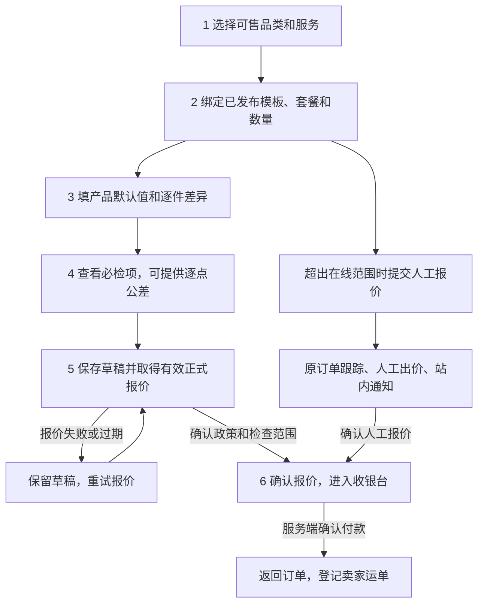

# My Workspace 客户中心整改报告

2026-11-11 · 基线 `34d66aa` · 本地工程验收

本轮续接已有七个未提交文件中的客户工作台改动。原 `.env` 指向的开发库和测试库共用一个已经不存在的本地 socket。验证改用本机 PostgreSQL 的独立数据库，分别执行空库关系校验、全量集成及 Chrome。目录、仓址、凭证、运单、图片、支付和角色账号均为隔离夹具。测试未触发外部实物操作或真实交易。

## 实际路由与页面审查

| 模块 | 代码确认的客户入口 | 实际数据与操作 | 验收边界 |
| --- | --- | --- | --- |
| 工作台 | `/account` | PostgreSQL 汇总未结订单、包裹入仓、待处置实物和待确认报价。显示最多三项实际待办、当前默认仓址、永久码、最近订单和五条活动 | 真实业务仓址、地址变更专门提醒 OPEN |
| 下单 | `/orders/new`，支持 `offer` 和 `draft` 深链 | 主侧栏、单一六步进度、单一摘要。目录联动、已发布模板、逐件默认值与覆盖、草稿与真实报价 | 正式数量档交期、线上未发布组合、未配置附加检查 OPEN |
| 订单列表 | `/orders` | 服务端按订单号、状态、页码查询。按最新记录排序，显示逐件数量、质检状态、付款、报告及下一步。浏览器后退恢复筛选 | 以订单级状态汇总，逐件状态在详情 |
| 订单详情 | `/orders/{publicNo}`，子页 `/payment`、`/parcels`、`/dispositions`、`/storage` | 展示创建、付款、到齐、报告发布、结案等已记录时间。原单支付恢复、实际到仓、范围、售后和逐件处置 | 暂停及异常按实际工单和状态展示，特定短少恢复见 E2E-04 |
| 订单履约详情 | `/orders/{publicNo}/quotes/{id}`、`/orders/{publicNo}/shipments/{id}`、`/orders/{publicNo}/cases/{id}` | 报价版本、仓库交接、运单和工单使用原单与对象双重约束 | 有效正式运输价格及提供方联调 OPEN |
| 待办 | `/actions` | 草稿、待支付、卖家追踪、正式人工报价、待选处置、物流验证、范围修订、参考样、续存及客户待回复工单有深链 | 泛化暂停不再单独计作客户待办。人工收件归属审核期间不暴露未匹配仓库对象 |
| 报告 | `/reports`、`/orders/{publicNo}/report`、`/orders/{publicNo}/report/versions/{n}` | 默认最新已发布，支持精确检索和查看历史。PDF 请求锁定同一版本。报告实物编号直达客户库存 | 公开分享沿用原开关，发布快照和私有证据隔离保留 |
| 包裹 | `/parcels`、`/parcels/{id}`、`/shipments/{id}` | 登记运单、绑定本人订单、入仓与承运商状态分列、认领指定运单、出库追踪。列表按 Incoming、Received、Needs Attention、Outgoing 切换 | 客户主动提交特定运单证明。包裹供应商、预计件数结构化申报和外箱证据权限投影 OPEN |
| 实物 | `/items`，实物使用 `#item-{code}` 定位，详情为抽屉 | 实物编号、所属委托、检查与保管状态。按实物提交不同去向，支持退商家、集运、续存和确认样。待封存状态独立展示 | 可用列表仍受现有读取上限约束。批量申请会反馈已成功处理的实物 |
| 账单 | `/account/billing`，兼容 `/billing` | 分开待确认报价、收费和退款。展示测试支付标记、真实支付记录时间、部分及全额退款、订单关联。过期未付费用提供原单入口 | 正式收据下载 OPEN |
| 通知 | `/account/notifications`，兼容 `/notifications` | 所属对象深链，已读写回，未读计数、游标分页。付款、入库、报告和封存使用现有事件去重键 | 邮件与实际承运商事件联调 OPEN |
| 支持 | `/support`、`/support/cases/{id}` | 创建真实工单、显示工单号、历史及公开对话、客户回复及证据附件。内部备注经过服务端过滤 | 客户自行关闭或重新开启、独立包裹关联、创建时直接上传附件 OPEN |
| 账户安全 | `/account/security` | 邮箱、登录方式、设备、敏感操作重新认证、导出与账户关闭。永久码显示于账户与安全页面 | 独立资料编辑、语言与通知偏好 OPEN |
| 测试收银台 | `/checkout/demo/{id}` | 隔离模式确认真实数据库收费记录。付款后回到原检验订单。客户隔离与重复确认由服务端验证 | Stripe 沙盒及正式验收 OPEN |

公开恢复入口为 `/account/recovery`，登录、注册和 onboarding 沿用现有路由。外部分享 `/r/{token}` 不列入客户主导航。路由清单来自 `packages/core/portal-routes.ts` 与 `app/portal.tsx`。

## 六步工作流

报价快照锁定订单行、Offer、SKU 价格版本、模板版本、数量、金额、币种和有效期。交期使用对应目录规则和正式报价明细，并在实物到齐、已识别后按既有营业日规则计时。改动已审阅的内容会使界面不再显示旧报价，重复请求使用幂等键。向导在合法输入后自动保存，步骤切换、手动保存和带草稿号刷新均访问服务端草稿。逐件位置在付款后独立生成，填写运单没有仓库实收效力。

## 根因与变更

| 问题 | 可复核证据 | 整改 |
| --- | --- | --- |
| 404 后停在报价计算 | HEAD 创建草稿得到 `id`，向导读取了 `created.order_id`，随后 GET `/api/v1/orders/undefined`。真正报价为 `POST /api/v1/orders/{id}/quotes`，接收 `revision`，需客户会话、同源 CSRF 及幂等键，成功返回 201。编辑时备注字段亦与 OpenAPI 有差异 | 从创建或编辑 DTO 直接取得 ID 和 revision，省去中间 GET。新建省略空备注，PATCH 支持保留和清空。报价超时、HTTP 错误和过期分别反馈，Retry 继续同一草稿。正式报价失败的 Review 不展示旧估价 |
| 服装检查点混用 | 通用演示模板保存基础项目及带 `applies_if` 的专项点。历史客户端直接列 Offer 内容，显示范围没有复用仓库条件。专项 Offer 和三件通用对比的数量条件也不同 | 依据已发布模板元数据绑定，不以 SKU 字符串推断模板。预览与仓库复用条件规则。草稿可附带已审阅模板版本，旧版冲突和专项品类不符被服务器拒绝 |
| 15 mm 自动公差 | HEAD 把输入初始为 15，保存为 `tolerances.dimension_mm`。报告判定读取带检查点、最小值、最大值和单位的数组。旧字段并未提供有效逐点判定 | 默认只记录实测。逐点填写目标值和公差，单位沿用模板。已发布报告和历史订单原值不变 |
| 双六步导航和摘要操作拥挤 | HEAD 同时有 New Inspection 专属侧栏和正文进度组件。HEAD 源码可确认摘要、页头、报价区存在重叠操作语义。历史截图的第二份摘要实例没有独立部署证据 | 删除向导侧栏及跨组件步骤事件。统一步骤编号，保留唯一摘要与保存入口，重置需确认。Chrome 断言唯一进度和摘要 |
| 共享页头和窄表格 | 初次 Chrome 矩阵测到演示页头把退出按钮挤出视口，通知和账单内容在手机出现严重断词 | 调整客户页头断点，保留账户退出和移动导航。客户密集表格以字段卡片显示。报告比较表保留可横向滚动的列 |
| 出库批次运单入口失效 | 客户批次读取返回运单字符串和扁平报价字段，组件将其当成带 ID 的对象和嵌套报价。Chrome 暴露出缺失 React key，按钮也拿不到运单对象 | 服务端增加已交接运单 ID 与号码，保留原字段兼容。列表用正确的报价字段，运单打开真实客户物流详情 |
| 确认短少后无法恢复 | 库存短少写入 `quantity_discrepancy`，原恢复接口只清除员工暂停。仓库候选和绑定也排除了短少暂停单 | 只对等待收货时因短少冻结的订单开放补件核验绑定。相关短少工单结案、所有范围内实物已经识别且其他冻结已解除后，员工可在原恢复入口排队。保留审计记录，范围、数量和原收费快照不变 |

## 十类端到端回归

结果来自真实隔离数据库及接口。Chrome 报价故障中的 404、422、409、500 和超时通过浏览器网络注入复现，服务端另以真实路由与版本校验重测 404、422、409。通过后续请求取得真实报价并在隔离收银台完成付款。

| 场景 | 结果 | 证据与限制 |
| --- | --- | --- |
| E2E-01 单件样品质检 | 隔离 API 通过 | 单件注册领码、实际 PostgreSQL 订单与收费、入仓、质检、独立复核、PDF 和发运在品类全链用例覆盖。浏览器验证报价到付款回原订单 |
| E2E-02 三家供应商比较 | 隔离 API 通过 | 三件申报具有不同供应商与运单，分别入三个包裹，同一对比报告包含三件，分别申请退货、保管和转运 |
| E2E-03 30 件小批量 | 隔离 API 通过 | 独立 30 件订单完成批量申报、正式目录报价、付款、三包分批收货、30 个独立任务、瑕疵与证据发布及实际转运接口回写 |
| E2E-04 10 件收 8 件 | 隔离 API 通过 | 区分在途与实际短少，待办和工单绑定，客户回复后仍阻止未补齐时恢复。补入两件后经员工恢复并生成十项质检任务 |
| E2E-05 确认样 | 隔离 API 通过 | NEW 四步回归验证待封存、错误铅封拒绝、实物移入参考区、激活、站内通知及后续参考样匹配资格 |
| E2E-06 检后退货 | 隔离 API 通过 | 在同一件实物上断言报告瑕疵标注和私有图像、客户退货授权、报价、付款、打包、承运商交接及原单运单。单一浏览器串联脚本 OPEN |
| E2E-07 部分转运 | 隔离 API 通过 | 在同一个 30 件订单验证退货、已封存确认样和转运的独立实物状态，核对两个发运批次的各自报价、付款、承运商运单及关联账单 |
| E2E-08 报价失败 | 隔离 Chrome 与 API 通过 | 失败保留服务端草稿，所有错误情况下禁用付款，Retry 返回真实 201，校验模板、价格、金额和有效期。隔离测试复验旧收费过期及原单重报 |
| E2E-09 数据隔离 | 隔离 Chrome 与 API 通过 | 两个客户，收件码和报价隔离，跨租户报告、PDF、包裹、工单、账单和逐件操作在相应接口被拦截。审核和质检使用各自真实角色会话 |
| E2E-10 浏览器恢复 | 代表性 Chrome 回归通过，边界 OPEN | 验证刷新回草稿、列表筛选随前进后退恢复、报价连接超时重试、支付双击和重放、失效会话回登录并带原路径。尚未提交到服务端的输入遇到立即断网刷新、以及跨设备同时编辑的完整恢复矩阵仍待补 |

## OPEN 与 NEEDS_BUSINESS_DECISION

- **NEEDS_BUSINESS_DECISION** 正式仓址、法律文本、正式类别/套餐、数量档时效与发布审批。当前批准目录与项目约定保持有效。复杂批量继续通过真实人工报价。
- **NEEDS_BUSINESS_DECISION** Stripe 已打开的外部 Checkout 在报价到期后是否必须强制关闭。应用拒绝过期报价的提交及新建付款尝试。已受理的 Stripe 会话继续沿用现有恢复和晚到款核对。Stripe Checkout 创建时可配置的到期时间有 30 分钟下限，需业务确认会话撤销及晚到款处理方案，并在沙盒验收。[Stripe Checkout Session API](https://docs.stripe.com/api/checkout/sessions/create#create_checkout_session-expires_at)
- **OPEN** 真实 Stripe 沙盒交易、真实 Postmark/承运商、实仓硬件和正式收据。上线资格继续按 PRD §17、规格 §23 与原 TASK 留证。
- **OPEN** 多件库存列表的服务端分页、客户可见包裹外箱证据授权、支持工单客户重开与关闭、资料与偏好。后台能力或权限模型变更须按原 TASK 和业务方确认。
- **OPEN** 原始数据库服务恢复后，对正式已发布目录、客户对象和历史草稿进行只读兼容核验。隔离数据库验证覆盖空库及本轮基线测试。

## 复现与证据

| 命令 | 退出码 | 结果 |
| --- | --- | --- |
| `npm run check` | 0 | TypeScript 检查通过 |
| `npm run build` | 0 | Next.js 生产构建通过 |
| `python3 docs/contracts/check.py` | 0 | 42 个交易操作，174 个 TASK，69 张页面，111 个实施用例，46 个产品门禁 |
| `npm run test:integration` | 0 | 56/56，含 AUD-001–015、NEW-001–011、付款回调重复与乱序、模板版本、30 个独立位置、三供应商、确认样与精确短少恢复 |
| `psql -v ON_ERROR_STOP=1 -f docs/contracts/verify.sql` | 0 | 迁移 001–008 后在未播种的空库运行，关系断言通过 |
| `node tests/workspace.browser.mjs` | 0 | Chrome 覆盖 1440、1280、1024、768、390 和 375 px，客户与两种员工角色，28 个页面或步骤共 168 张截图 |

[截图索引](/private/tmp/qcw-workspace-evidence/index.html) · [原始截图压缩包](/private/tmp/qcw-workspace-screenshots-2026-11-11.zip) · [浏览器输出](/private/tmp/qcw-workspace-browser-final.log) · [集成输出](/private/tmp/qcw-workspace-integration-final.log)

运行 Chrome 测试时在隔离演示实例设置 `QCW_BROWSER_URL` 与 `QCW_BROWSER_EVIDENCE`。Playwright 可安装到临时目录，并以 `QCW_PLAYWRIGHT_MODULE` 指向它的入口。可选 `QCW_BROWSER_FIXTURE_EMAIL` 使用集成库中有已发布报告、入仓、出库和工单的 `@qcw.test` 账号，以保存非空页面。脚本会为新客户走 OTP 和注册，现有隔离角色可用开发环境登录签发真实会话。

验收状态及回退见 [开发排期与任务台账](开发排期与任务台账.md)。提交号可用 `git log -1 -- docs/My-Workspace整改报告.md` 核对。
