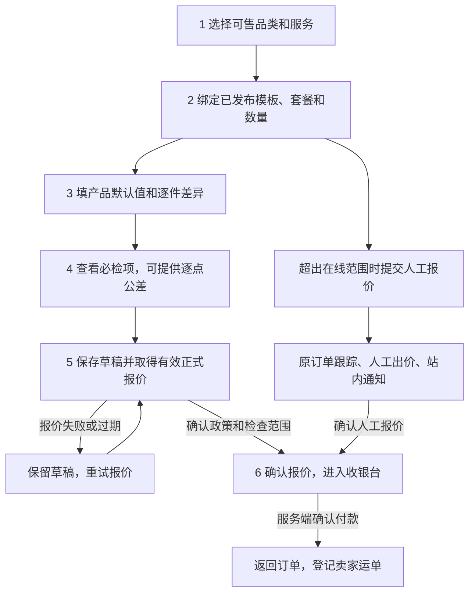

# My Workspace 客户中心整改报告

2026-11-11 至 2026-11-13 · 基线 `34d66aa` · 本地工程验收 · 外部验收 OPEN

本轮续接已有七个未提交文件中的客户工作台改动。原 `.env` 指向的开发库和测试库共用一个已经不存在的本地 socket。`.env` 保持原配置，验证使用本机 PostgreSQL 的独立数据库，分别执行空库关系校验、全量集成及 Chrome。目录、仓址、凭证、运单、图片、支付和角色账号均为隔离夹具。测试未触发外部实物操作或真实交易。

## 实际路由与页面审查

| 模块 | 代码确认的客户入口 | 实际数据与操作 | 验收边界 |
| --- | --- | --- | --- |
| 工作台 | `/account` | PostgreSQL 汇总未结订单、包裹入仓、待处置实物和待确认报价。显示最多三项实际待办、当前默认仓址、永久码、最近订单和五条活动 | 已生效的默认仓址切换为旧账户显示审计时间和新地址提示。真实业务仓址 OPEN |
| 下单 | `/orders/new`，支持 `offer` 和 `draft` 深链 | 主侧栏、单一六步进度、单一摘要。目录联动、已发布模板、逐件默认值与覆盖、草稿与真实报价 | 正式数量档交期、线上未发布组合、未配置附加检查 OPEN |
| 订单列表 | `/orders` | 服务端按订单号、状态、页码查询。按最新记录排序，显示逐件数量、质检状态、付款、报告及下一步。浏览器后退恢复筛选 | 以订单级状态汇总，逐件状态在详情 |
| 订单详情 | `/orders/{publicNo}`，子页 `/payment`、`/parcels`、`/dispositions`、`/storage` | 展示创建、付款、到齐、报告发布、结案等已记录时间。原单支付恢复、实际到仓、范围、售后和逐件处置 | 暂停及异常按实际工单和状态展示，特定短少恢复见 E2E-04 |
| 订单履约详情 | `/orders/{publicNo}/quotes/{id}`、`/orders/{publicNo}/shipments/{id}`、`/orders/{publicNo}/cases/{id}` | 报价版本、仓库交接、运单和工单使用原单与对象双重约束。已交接出库可从 `/shipments/{id}` 直接查看，包括无质检订单的发运 | 有效正式运输价格及提供方联调 OPEN |
| 待办 | `/actions` | 草稿、待支付、卖家追踪、人工报价确认与过期续询、待选处置、物流验证、范围修订、参考样、续存及客户待回复工单有深链 | 泛化暂停不再单独计作客户待办。人工收件归属审核期间不暴露未匹配仓库对象 |
| 报告 | `/reports`、`/orders/{publicNo}/report`、`/orders/{publicNo}/report/versions/{n}` | 默认最新已发布，支持精确检索和查看历史。PDF 请求锁定同一版本。报告实物编号直达客户库存 | 公开分享沿用原开关，发布快照和私有证据隔离保留 |
| 包裹 | `/parcels`、`/parcels?tab=attention`、`/parcels/{id}`、`/shipments/{id}` | 登记运单、绑定本人订单、入仓与承运商状态分列、认领指定运单、出库追踪。待核验申请可分页查看，支持补充回复和结果通知。归属核实后可从原工单打开包裹，查看仓库登记时间、件数和外箱状况 | 通过已关联订单的逐件运单读取供应商和预计件数，与仓库记录数量分列。独立包裹的供应商和件数申报、原始外箱照发布规则 OPEN |
| 实物 | `/items`，实物使用 `?item={code}` 打开抽屉，兼容 `#item-{code}` | 实物编号、所属委托、检查与保管状态。按实物提交不同去向，支持退商家、集运、续存和确认样。待封存状态独立展示 | 每页 20 件，统计与筛选来自全部本人库存。选择跨页保留，提交后回读真实逐件指令 |
| 账单 | `/account/billing`，兼容 `/billing`，用 `?charge={id}` 定位具体收费 | 分开待确认报价、收费和退款。按入账或报价接受时间展示，区分测试付款。订单、待办或通知可直接定位本人历史收费。退货、发运和续存收费显示其关联订单 | Stripe 沙盒及正式主体收据验收 OPEN |
| 通知 | `/account/notifications`，兼容 `/notifications` | 所属对象深链、关联工单或运单编号、已读写回、未读计数、游标分页。付款、入库、报告和封存使用现有事件去重键 | 邮件与实际承运商事件联调 OPEN |
| 支持 | `/support`、`/support/cases/{id}` | 创建工单、按工单号或订单号查找、按状态筛选并分页。旧工单有公开回复时排到前面，详情支持公开对话、客户回复及证据附件 | 可从本人包裹进入工单，创建时附照片，客户与授权客服可查看。客户自行关闭或重新开启 NEEDS_BUSINESS_DECISION |
| 账户安全 | `/account/security` | 邮箱、登录方式、设备、敏感操作重新认证、导出与账户关闭。永久码显示于账户与安全页面 | 可编辑昵称与显示时区，服务端验证并应用于工作台日期。语言与通知偏好未有对应设置工作流 |
| 测试收银台 | `/checkout/demo/{id}` | 隔离模式确认真实数据库收费记录。付款后回到原检验订单。客户隔离与重复确认由服务端验证 | Stripe 沙盒及正式验收 OPEN |

公开恢复入口为 `/account/recovery`，登录、注册和 onboarding 沿用现有路由。外部分享 `/r/{token}` 不列入客户主导航。路由清单来自 `packages/core/portal-routes.ts` 与 `app/portal.tsx`。

## 六步工作流

报价快照锁定订单行、Offer、SKU 价格版本、模板版本、数量、金额、币种和有效期。交期使用对应目录规则和正式报价明细，并在实物到齐、已识别后按既有营业日规则计时。改动已审阅的内容会使界面不再显示旧报价，重复请求使用幂等键。向导在合法输入后自动保存，步骤切换、手动保存和带草稿号刷新均访问服务端草稿。逐件位置在付款后独立生成，填写运单没有仓库实收效力。

## 根因与变更

| 问题 | 可复核证据 | 整改 |
| --- | --- | --- |
| 404 后停在报价计算 | HEAD 创建草稿得到 `id`，向导读取了 `created.order_id`，随后 GET `/api/v1/orders/undefined`。真正报价为 `POST /api/v1/orders/{id}/quotes`，接收 `revision`，需客户会话、同源 CSRF 及幂等键，成功返回 201。编辑时备注字段亦与 OpenAPI 有差异 | 从创建或编辑 DTO 直接取得 ID 和 revision，省去中间 GET。新建省略空备注，PATCH 支持保留和清空。报价超时、HTTP 错误和过期分别反馈，Retry 继续同一草稿。正式报价失败的 Review 不展示旧估价 |
| 服装检查点混用 | 通用演示模板保存基础项目及带 `applies_if` 的专项点。历史客户端直接列 Offer 内容，显示范围没有复用仓库条件。专项 Offer 和三件通用对比的数量条件也不同 | 依据已发布模板元数据绑定，不以 SKU 字符串推断模板。预览与仓库复用条件规则。草稿可附带已审阅模板版本，旧版冲突和专项品类不符被服务器拒绝 |
| 15 mm 自动公差 | HEAD 把输入初始为 15，保存为 `tolerances.dimension_mm`。报告判定读取带检查点、最小值、最大值和单位的数组。旧字段并未提供有效逐点判定 | 默认只记录实测。逐点填写目标值和公差，单位沿用模板。已发布报告和历史订单原值不变 |
| 服务卡最低价 | 视觉复验发现第一步从目录取最低单价后直接展示为每件价格。默认已选模板的单价可能更高，摘要据此计算 | 有不同有效单价时显示 `From`。套餐根据有效报价显示固定价或区间，未开放服务标为不可用。摘要仍按当前模板与数量估算 |
| 双六步导航和摘要操作拥挤 | HEAD 同时有 New Inspection 专属侧栏和正文进度组件。HEAD 源码可确认摘要、页头、报价区存在重叠操作语义。历史截图的第二份摘要实例没有独立部署证据 | 删除向导侧栏及跨组件步骤事件。统一步骤编号，保留唯一摘要与保存入口，重置需确认。Chrome 断言唯一进度和摘要 |
| 共享页头和窄表格 | 初次 Chrome 矩阵测到演示页头把退出按钮挤出视口，通知和账单内容在手机出现严重断词 | 调整客户页头断点，保留账户退出和移动导航。客户密集表格以字段卡片显示。报告比较表保留可横向滚动的列 |
| 出库批次运单入口失效 | 客户批次读取返回运单字符串和扁平报价字段，组件将其当成带 ID 的对象和嵌套报价。Chrome 暴露出缺失 React key，按钮也拿不到运单对象 | 服务端增加已交接运单 ID 与号码，保留原字段兼容。列表用正确的报价字段，运单打开真实客户物流详情 |
| 确认短少后无法恢复 | 库存短少写入 `quantity_discrepancy`，原恢复接口只清除员工暂停。仓库候选和绑定也排除了短少暂停单 | 只对等待收货时因短少冻结的订单开放补件核验绑定。相关短少工单结案、所有范围内实物已经识别且其他冻结已解除后，员工可在原恢复入口排队。保留审计记录，范围、数量和原收费快照不变 |

| 续做事项 | 根因与修复 | 证据 |
| --- | --- | --- |
| 浏览器中断 | 原实现只恢复已成功写入的内容。当前标签页按客户和草稿暂存输入，服务端写入仍使用原草稿版本和幂等守卫。创建响应丢失后先重放原请求，再把后续编辑写到同一草稿 | Chrome 断网刷新、真实创建丢响应、两标签页竞争及数据库唯一草稿断言 |
| 账单收据 | 账单原来仅有处理商引用。新增按收费项读取的会话鉴权入口，逐笔核对入账、组织、付款与渠道对象。正式链接按需读取 | 已签名测试回调写入数据库，隔离渠道响应验证正常链接、错误组织/金额/URL 和跨租户、未付款访问 |
| 账单日期与原单定位 | 原列表按随机收费 ID 截取最近 200 条，旧通知可能找不到相应账目。现按业务日期倒序，指定收费仅在本人记录内优先读取。续存从报价接受时的实物关联查找原订单，退款沿用收费原单 | 用 205 条历史收费核对顺序、旧链接与另一客户的不可见性；在 Chrome 核对从付款页跳转和准确焦点 |
| 窄屏卡片文字 | 375 px 实拍发现付款状态和长实物编号在卡片内被截断，即使整页宽度正常。客户状态和编号现在可在各自单元格内换行 | 复核 375 px 原图；Chrome 在移动截图同时检查状态和编号的文本边界，比较报告保留可滚动对照表 |
| 大批量实物 | 原列表以已加载记录计算数量并截断。按本人库存分页查询并计算总量，以实物码授权打开报告关联物品 | 30 件跨两页分布、状态过滤、确认样及跨租户隔离。Chrome 两页选择提交真实续存指令 |
| 客户支持 | 原包裹和工单分开，首条消息无法提交证据。工单现在可带已授权入库运单和首条私有照片 | Chrome 从真实包裹提单与查看关联，真实工单/照片数据库记录和跨租户拦截 |
| 工单历史 | 原列表只读取最近创建的 100 条，旧工单的新回复可能被遗漏。客户列表现按客户可见更新排序，可按状态和工单号或订单号查找，每页 20 条 | 隔离库验证 101 条分页、相同时间稳定排序、旧工单公开回复后前移、内部备注不改变排序及跨客户不可见。Chrome 验证翻页、详情、返回和筛选 |
| 资料和地址 | 显示时区原来无写入端。客户设置持久化到现有用户字段，登录方式、邮箱和接收码照常使用。地址提示由真正的默认地址变更审计产生 | Chrome 保存与重开资料、订单日期显示。数据库核验过往包裹地址快照、换址、重复设置和新注册账户 |
| 人工报价续询 | 原报价过期后旧申请仍挡住续询，超量订单接受报价后也不能用自动报价恢复。现可在原草稿或未付款原单续询，待办、账单、员工队列和通知按当前可用报价更新 | 隔离数据库核对过期、处理中付款守卫、旧收费金额留档及替换、跨客户隔离。Chrome 验证续询到同单付款 |
| 运费与续存重报 | 已接受的履约报价过期后，客户详情仍提供付款，仓管也不能在原对象续报。现由原发运队列或续存队列重新出具版本，旧收费保留历史。渠道会话未决时继续等待核对，账单及待办只提供有效报价，续存出价有站内通知 | 隔离数据库核对签名会话到期、重复与迟到款对账、报价通知去重及一次续存入账；Chrome 验证仓管出价和客户在同一批次或指令上付款 |
| 范围补款重报 | 已接受的范围补款过期后仍显示付款，账单指向原付款，订单概览只提示登记运单。客户可确认同一范围和差额后在原单获得新版本。订单列表、订单概览、账单和待办显示当前补款，付款回跳定位对应变更 | 隔离数据库核对未决付款、幂等、旧账保留、签名迟到款一次对账及范围只生效一次。Chrome 验证准确深链、原单提示和付款回跳 |
| 移动端实物与报告 | 实物抽屉补可访问名称、初始焦点、键盘环绕和返回焦点，只展示客户可读属性。移动报告普通表改为带字段名的记录卡，样品比较保留横向对照表 | Chrome 从后续库存页打开实物、检查焦点，核对现版、历史版 PDF 与移动对比表 |
| 分批寄样待办 | 原查询只检查订单是否有任一预报。登记第一包会隐藏后续已申报但尚未关联的运单。现按订单在范围内的实物位置、有效预报及已经绑定的入库运输记录判定。包裹页可选原单已申报的运单，选择后预填，可手工登记新运单 | 30 件三包逐次登记、先登记后绑定、规范化匹配、隔离检查、待办消失与仓库独立实收。Chrome 核对待办深链和原单登记 |
| 运单更正 | 已有关联预报的订单会保留更正前后的关联关系。承运商要求面单电话时，更正表单按目录提示收集并通过既有校验加密写入。原单入库列表显示承运商英文名称 | 验证缺电话、成功加密、跨客户拦截、客户纠错后旧运单待办不重新出现，以及实收后不可自助更正 |

## 十类端到端回归

结果来自真实隔离数据库及接口。E2E-01–07 的实体操作保留实仓验收。Chrome 报价故障中的 404、422、409、500 和超时通过浏览器网络注入复现，服务端另以真实路由与版本校验重测 404、422、409。通过后续请求取得真实报价并在隔离收银台完成付款。

| 场景 | 结果 | 证据与限制 |
| --- | --- | --- |
| E2E-01 单件样品质检 | 隔离 API 通过 | 单件注册领码、实际 PostgreSQL 订单与收费、入仓、质检、独立复核、PDF 和发运在品类全链用例覆盖。浏览器验证报价到付款回原订单 |
| E2E-02 三家供应商比较 | 隔离 API 通过 | 三件申报具有不同供应商与运单，分别入三个包裹，同一对比报告包含三件，分别申请退货、保管和转运 |
| E2E-03 30 件小批量 | 隔离 API 通过 | 独立 30 件订单完成批量申报、服务端按隔离目录生成有效报价、付款、三包分批收货、30 个独立任务、瑕疵与证据发布及实际转运接口回写 |
| E2E-04 10 件收 8 件 | 隔离 API 通过 | 区分在途与实际短少，待办和工单绑定，客户回复后仍阻止未补齐时恢复。补入两件后经员工恢复并生成十项质检任务 |
| E2E-05 确认样 | 隔离 API 通过 | NEW 四步回归验证待封存、错误铅封拒绝、实物移入参考区、激活、站内通知及后续参考样匹配资格 |
| E2E-06 检后退货 | 隔离 API 通过 | 在同一件实物上断言报告瑕疵标注和私有图像、客户退货授权、报价、付款、打包、承运商交接及原单运单。Chrome 另外验证客户证据与逐件处置入口。实仓交接 OPEN |
| E2E-07 部分转运 | 隔离 API 通过 | 在同一个 30 件订单验证退货、已封存确认样和转运的独立实物状态，核对两个发运批次的各自报价、付款、承运商运单及关联账单 |
| E2E-08 报价失败 | 隔离 Chrome 与 API 通过 | 失败保留服务端草稿，所有错误情况下禁用付款，Retry 返回真实 201，校验模板、价格、金额和有效期。隔离测试复验原单重报、过期报价拒绝返回旧会话链接、重复请求不能拿回缓存链接、创建会话跨过到期时间仍保留渠道记录，以及签名回调入账 |
| E2E-09 数据隔离 | 隔离 Chrome 与 API 通过 | 两个客户，收件码和报价隔离，跨租户报告、PDF、包裹、工单、账单和逐件操作在相应接口被拦截。审核和质检使用各自真实角色会话 |
| E2E-10 浏览器恢复 | 隔离 Chrome 与 API 通过 | 验证步骤刷新、列表前进后退、超时重试、支付双击和重放、会话失效跳转、未保存编辑断网刷新后恢复、服务端已创建但浏览器收不到响应时只建一份草稿、两标签页冲突后保留服务器最新版本并由用户选择是否保存浏览器编辑。跨设备读取已保存草稿沿用服务端版本守卫 |

## 数据与状态联动

| 联动关系 | 隔离数据库与接口断言 |
| --- | --- |
| 客户、订单与收件 | 两个客户的永久码及订单、包裹和工单隔离。换默认仓地址后历史运单地址快照仍指向原址。既有客户显示变更提示，新客户直接取得当前地址。 |
| 订单、报价与账单 | 草稿 revision、正式模板版本、有效 Offer/SKU 价格版本和数量进入同一报价。付款回调同一事件重放后只应用一笔收费。核对业务日期倒序、历史收费深链、续存原单、部分及全额退款、托管收据和租户归属。 |
| 订单、包裹与实物 | 30 件订单按三个运单分别申报、入库与识别。申报供应商和预计件数与仓库记录分开。短少恢复需补齐独立实物、结案并由员工复核。 |
| 实物、质检与报告 | 质检任务接收对应模板版本及范围。报告复核、发布和历史 PDF 按版本读取。报告的实物码打开本人对应库存，跨租户和未发布媒体受服务端授权。 |
| 实物、账单与工单 | 同一订单可按件续存、封存、转运或退货。发运按批次报价和入账，承运商交接后才有实际运单。工单可与本人包裹和私有附件关联，公开回复与内部备注分别验证。 |

## OPEN 与 NEEDS_BUSINESS_DECISION

- **NEEDS_BUSINESS_DECISION** 正式仓址、法律文本、正式类别/套餐、数量档时效与发布审批。当前批准目录与项目约定保持有效。复杂批量继续通过真实人工报价。
- **NEEDS_BUSINESS_DECISION** 客户已离开门户进入 Stripe 收银台时，报价到期如何关闭渠道端会话并处理在途或晚到款。门户已经拒绝发放过期报价的付款链接，涵盖已有会话和同键重放。Stripe 会话创建时可配置的到期时间有 30 分钟下限，渠道端撤销及晚到款处理仍需确认方案并在沙盒验收。[Stripe Checkout Session API](https://docs.stripe.com/api/checkout/sessions/create#create_checkout_session-expires_at)
- **OPEN** 真实 Stripe 沙盒交易及托管收据、正式经营主体配置、Postmark/承运商和实仓硬件。收据链接根据已入账收费及 Stripe 返回的关联 Charge 读取。正式发票按规格 C.7 的 R2 决策跟踪。 [Stripe 托管收据](https://docs.stripe.com/receipts) · [Stripe Charge 对象](https://docs.stripe.com/api/charges/object)
- **NEEDS_BUSINESS_DECISION** 未匹配和已归属包裹的原始外箱照片如何裁剪、复核及发布给客户。现有仓库入库照片含标签及可能的其他运单信息。客户可提交本人的包裹证明，复用工单私有附件。
- **NEEDS_BUSINESS_DECISION** 既有确认样接口的精确库位字段属于 NEW 回归保护范围。新增库存列表与实物抽屉使用已裁剪的客户字段。若需停发旧字段，应同时更新受保护的调用契约及验收用例。
- **NEEDS_BUSINESS_DECISION** 客户是否可主动关闭或重开工单，以及质检、索赔、退款和认领关联工单的限制。现有规则由授权客服结案，客户在开放工单内回复。
- **OPEN** 未委托包裹没有独立的供应商或逐件申报字段。已关联订单的预计数据从在范围内的逐件申报读取。全站切换语言与通知偏好无现成客户设置工作流，待确认支持范围。
- **OPEN** 原配置的 Unix socket 缺失，当前 PostgreSQL 实例没有 `qcw_dev`。用户已指出本机历史数据位于 `qcw_test-workspace-final`，本轮直接用其完成历史记录兼容性核验。该库 90 条主邮箱均为 `@qcw.test`，关闭账户另有两笔取消订单，关闭演示模式时当前应用返回 0 个可售 Offer。已核对的历史记录、收费和报告见本报告末尾。正式目录与外部渠道验收仍待真实环境。
- 续验责任与恢复条件：环境维护方恢复原项目数据库的授权连接；支付、邮件和物流集成负责人在隔离环境配置各自的供应商测试接入；仓库验收人提供可实际扫描、收货和交接的测试单与设备；业务负责人确认正式地址、条款、目录、交期、晚到款、包裹证据发布和工单规则后，按各原 TASK 继续验收。

| 外部续验 | 开始条件 | 应留存的证据 |
| --- | --- | --- |
| 原数据核对 | 原项目数据库恢复，使用授权只读连接 | 记录目录发布版本、订单和草稿数量、关联报价与发布报告版本。只保存核对计数和差异，不导出客户收件信息或私有证据。 |
| Stripe 沙盒 | 独立实例关闭 `QCW_DEMO`，预检显示 `stripe.mode=test`、`checkoutConfigured=true`、`liveEnabled=false`，测试 webhook 指向该实例 | 在 `/orders/new` 获取真实报价并用测试付款，核对订单、收费、回调重放、托管收据、退款；让测试会话到期后核对回调、重报价资格及旧费用留档。 |
| 邮件及物流 | Postmark 测试发送方、内部收件地址；快递100测试权限、HTTPS 回调和授权测试运单 | 按 TASK-146/151/169 核对邮件送达与退信、站内通知仍可见、轨迹查询/回调、校验电话和承运商签收不改变仓库实收。 |
| 实仓 | 仓库验收人、隔离测试订单、标签/扫码设备及明确交接安排 | 按 E2E-01–07 记录实际扫码、收货、补件、封存、证据、装箱及交接；比对订单、实物、报告与账单，生产出库仍走原授权。 |

## 复现与证据

| 命令 | 退出码 | 结果 |
| --- | --- | --- |
| `npm run check` | 0 | TypeScript 检查通过 |
| `npm run build` | 0 | Next.js 生产构建通过 |
| `python3 docs/contracts/check.py` | 0 | 45 个交易操作，174 个 TASK，69 张页面，111 个实施用例，46 个产品门禁 |
| `TEST_DATABASE_URL=postgresql://127.0.0.1/qcw_test-workspace-scope npm run test:integration` | 0 | 62/62，含 AUD-001–015、NEW-001–011、人工报价续询、运费与续存重报、范围补款、Stripe 签名回调、账单与收据归属、资料持久化、工单历史和原有履约全链 |
| `psql -h 127.0.0.1 -d qcw_test-workspace-continuation-relations -v ON_ERROR_STOP=1 -f docs/contracts/verify.sql` | 0 | 迁移 001–008 后在未播种的空库运行，关系断言通过 |
| `QCW_BROWSER_WORKSPACE_ONLY=1 node tests/workspace.browser.mjs` | 1 | 新客户、报价恢复、隔离付款和重放、跨页实物处置断言通过，采集 157 张原图后在等待 390 px 订单详情导航完成时超时。原图和逐图断言保留 |
| `QCW_BROWSER_RESUME_MATRIX=1 node tests/workspace.browser.mjs` | 0 | 在同一隔离副本补齐 41 张。完整矩阵覆盖 1440、1280、1024、768、390 和 375 px，33 个页面或状态共 198 张截图，整页横向溢出为 0。移动导航、历史 PDF、客户隔离及审核员和质检员的角色隔离通过 |
| `QCW_BROWSER_RECOVERY_ONLY=1 node tests/workspace.browser.mjs` | 0 | 创建响应丢失后重放、断网刷新、恢复联网后服务端保存、双标签页冲突和人工确认后保存。分别断言离线无写入、重连后写入和禁止覆盖较新版本 |
| `QCW_BROWSER_WORKSPACE_ONLY=1 QCW_BROWSER_NEW_CUSTOMER_ONLY=1 node tests/workspace.browser.mjs` | 0 | 最终复跑新客户、目录起价、报价、付款和重放。六档共 48 张替换工作台对应原图，整页横向溢出为 0 |
| `QCW_BROWSER_MANUAL_QUOTE_ONLY=1 node tests/workspace.browser.mjs` | 0 | 草稿及原单付款的人工报价过期、员工队列、账单回原单确认并付款。六种宽度共 18 张截图，整页横向溢出为 0 |
| `QCW_BROWSER_FULFILLMENT_ONLY=1 node tests/workspace.browser.mjs` | 0 | 发运和续存已接受报价过期、仓管重新报价、客户付款、跨租户读取拦截。六种宽度共 18 张截图，整页横向溢出为 0 |
| `node tests/workspace.browser.mjs`（`65742cd`） | 0 | 在新隔离数据库副本上重新执行完整 Chrome 回归，草稿恢复与全页矩阵在同一次运行通过。六档宽度、33 个页面或状态、198 张原图，整页横向溢出为 0 |
| `QCW_BROWSER_SCOPE_ONLY=1 node tests/workspace.browser.mjs` | 0 | 范围补款过期、账单与待办深链、重新确认、付款回跳、跨客户隔离。六种宽度共 12 张原图，整页横向溢出为 0 |
| `QCW_BROWSER_SUPPORT_ONLY=1 node tests/workspace.browser.mjs` | 0 | 工单翻页、按编号和状态筛选、返回历史及跨客户隔离。六种宽度共 6 张原图，整页横向溢出为 0 |
| `npm run integrations:check` | 0 | 本机配置预检。Stripe、Postmark、快递100尚无可用的沙盒配置 |

本机 Chrome 截图原图、视口断言、命令日志及 `index.html` 位于本轮持久交付目录 `qcwarehouse-acceptance-2026-11-12`。验收包和索引包含 198 张工作台全页截图、12 张范围补款、6 张工单历史、18 张人工报价续询及 18 张发运和续存重报截图，五组整页横向溢出均为 0。截图工具按页面可见加载状态等待，对长报告分段捕获并拼接为完整原图。验收包保留前次捕获超时及磁盘空间不足的诊断日志。截图和日志未纳入代码仓库。

运行 Chrome 测试时在隔离演示实例设置 `QCW_BROWSER_URL` 与 `QCW_BROWSER_EVIDENCE`。Playwright 可安装到临时目录，并以 `QCW_PLAYWRIGHT_MODULE` 指向它的入口。`QCW_BROWSER_FIXTURE_EMAIL` 使用集成库中有已发布报告、历史版本、入仓、出库和工单的 `@qcw.test` 账号，以保存非空页面。`QCW_BROWSER_INVENTORY_EMAIL` 使用至少 21 件待指示实物的夹具账号。跨页回归会为两件实物创建真实测试续存指令，请在独立数据库副本运行。`QCW_BROWSER_COMPARISON_EMAIL` 使用已有发布对比报告的客户夹具。脚本会为新客户走 OTP 和注册，现有隔离角色可用开发环境登录签发真实会话。

履约重报模式使用与本机应用一致的 `QCW_BROWSER_DATABASE_URL`（仅接受 `127.0.0.1` 上的 `qcw_test-*`）和有至少两件待指示实物的 `QCW_BROWSER_INVENTORY_EMAIL`，缩短新建测试报价的有效期以复现真实过期。范围补款回归同样只在浏览器副本缩短测试快照的有效期。

上述全量集成基线在 `qcw_test-workspace-scope` 执行。Chrome 使用该库的独立副本，专项复验使用 `qcw_test-workspace-continuation-visual`，完整页面矩阵使用 `qcw_test-workspace-continuation-chrome-final`。两次续验均保留已有 `qcw_test-workspace-final` 快照。当前 `http://localhost:3000/` 使用本机历史验证副本，详见本机历史数据核验一节。

集成库的箱包、家居及鞋类使用测试能力审批。截图中的可售状态由该目录产生。正式可售品类仍以原项目已发布目录为准。

验收期间本机 PostgreSQL 重新启动，浏览器副本一度因 `outbox_events_pkey` 冲突拒绝注册。注册事务回滚，随后用新测试客户从 OTP、同意当前条款到领码重新验证，注册和收件资料请求均返回 200。该复验未修改注册逻辑、数据库结构或原库配置。

验收状态及回退见 [开发排期与任务台账](开发排期与任务台账.md)。提交号可用 `git log -1 -- docs/My-Workspace整改报告.md` 核对。

## 分批寄样续验

续做基线 `94c1905`。原项目配置仍指向缺失的 Unix socket，本机 PostgreSQL 仍未发现 `qcw_dev`。本地预览返回 200，供应商预检仍缺 Stripe 沙盒、Postmark 和快递100配置。

| 命令 | 退出码 | 证据 |
| --- | --- | --- |
| `npm run check`、`npm run build`、`python3 docs/contracts/check.py` | 0 | 类型、构建及 45 个交易操作契约通过 |
| `TEST_DATABASE_URL=postgresql://127.0.0.1/qcw_test-workspace-parcel-followup npm run test:integration` | 0 | 62/62，包括三包 30 件、运单更正、复核/仓库角色和 AUD/NEW 回归 |
| `psql -h 127.0.0.1 -d qcw_test-workspace-continuation-relations -v ON_ERROR_STOP=1 -f docs/contracts/verify.sql` | 0 | 空库关系用例事务通过 |
| `QCW_BROWSER_WORKSPACE_ONLY=1 QCW_BROWSER_NEW_CUSTOMER_ONLY=1 node tests/workspace.browser.mjs` | 0 | 在独立浏览器副本 `qcw_test-workspace-parcel-browser` 验证新客户、付款、待办深链、两包逐次登记、顺丰运单更正和回到原单。11 个页面或状态，六档视口共 66 张原图，整页横向溢出为 0 |

增量 Chrome 原图、索引及日志位于 `qcwarehouse-parcel-followup`。它补充前次 252 张全页面证据，重点更新分批预报、运单纠错和待仓库实收的订单状态。承运商实际查询和实仓交接仍按外部续验条件跟踪。

## 客户理赔续验

续做基线 `f18ea8b`。后台独立批准后写入 `approved_awaiting_customer`，旧工单页面用 `customer_pending` 判断表单，导致客户无法在工单中提交决策。旧待办依赖 `tickets.state`，普通回复会把工单转给客服而提前移除决策待办。现在事故状态统一决定表单和待办，批准时沿用工单通知 Worker。未批准的方案金额和摘要不在客户端发布。实际赔付凭证与客户接受、服务费退款分别显示。

`npm run check`、`npm run build`、`python3 docs/contracts/check.py`、空库关系校验及 `TEST_DATABASE_URL=postgresql://127.0.0.1/qcw_test-workspace-incident-followup npm run test:integration` 均退出 0，集成 62/62。`QCW_BROWSER_INCIDENT_ONLY=1 node tests/workspace.browser.mjs` 在独立库 `qcw_test-workspace-incident-browser` 退出 0，覆盖仓库、独立审核和两个客户角色，确认审批前无金额、普通回复不清待办、接受后待赔付及录入测试凭证后显示已登记。六档 24 张原图无整页横向溢出，原图、索引及命令日志位于 `qcwarehouse-incident-followup`。正式赔付条款及外部核验仍按原门禁跟踪。

## 履约报价通知续验

续做基线 `638cd6b`。发运和续存通知原先跳到账单首页，旧报价过期后也从待确认列表消失。现按当前客户组织核对通知中的报价 ID，进入账单并定位该份原报价。待办复用同一链接。原单报价和账单详情复用服务端状态，历史报价保留金额、实物和报价版本。账单的待支付记录根据报价有效期和渠道确认状态显示过期或处理中，过期时不再提供付款入口。

`npm run check`、`npm run build`、`python3 docs/contracts/check.py`、空库关系校验及 `TEST_DATABASE_URL=postgresql://127.0.0.1/qcw_test-workspace-quote-notice npm run test:integration` 均退出 0，集成 62/62。验证真实通知、旧版本读取、跨客户及工作人员读取拦截和账单快照。`QCW_BROWSER_FULFILLMENT_ONLY=1 QCW_BROWSER_QUOTE_NOTICE_CHECK=1 node tests/workspace.browser.mjs` 在独立库 `qcw_test-workspace-quote-notice-browser` 运行真实 Worker 与 Chrome，验证通知打开、焦点、过期状态、原单重报价、隔离付款和回读。六档 30 张原图及日志位于 `qcwarehouse-quote-notice-followup`。

## 2026-11-13 · 本机历史数据核验

依据用户提供的本机实例信息，用 `default_transaction_read_only=on` 读取 `127.0.0.1:5432/qcw_test-workspace-final`。保留源库，使用 PostgreSQL 创建副本 `qcw_test-workspace-historical-review`。副本通过迁移校验，应用继续使用当前 Git HEAD。副本运行时在 localhost:3000 提供历史预览，`.env` 保持原配置。

| 核验项 | 结果 |
| --- | --- |
| 历史资产 | 77 笔订单，27 笔草稿，50 个包裹，134 件实物，91 个用户，12 份已发布报告和 15 条报告版本记录 |
| 目录与历史草稿 | 当前目录 API 读取 13 个演示 Offer，包含 10 个服装 Offer。27 笔草稿均有逐件申报和有效模板关联，覆盖两个模板版本。实际 API 对照全部 27 笔数量、模板、revision 和逐件数据。390px Chrome 打开两个模板版本的历史草稿，确认原单链接、唯一进度和摘要，无整页横向溢出 |
| 订单与收费 | 75 笔由可登录测试账户创建的订单通过客户 API 逐单核对状态、实物及包裹列表。另两笔归于已关闭账号，状态为已取消，在只读 SQL 核对。49 笔订单引用的报价全部存在。257 条已接受报价关联收费的金额和币种一致 |
| 报告和权限 | 12 个当前发布指针均命中有效版本，14 个已发布或历史 PDF 文件实际下载并与冻结哈希比对。另有 1 条未发布版本保留在库内。跨客户报告与 PDF 请求共 28 次均被拒绝。另抽查两份报告的私有图片可由本人读取，跨客户均被拒绝 |
| 快照保护 | 源库与完成核验的副本中，订单、订单行、检验报价、收费及报告版本五组记录的聚合 SHA-256 一致。关闭演示模式后当前应用从源库读取 0 个可售 Offer。5 笔没有测试标记的订单仍由 `@qcw.test` 账户创建，其所用服务均有演示价格历史 |

命令、计数、哈希和浏览器复验日志保存在 `qcwarehouse-historical-verification`。核验未导出报告文件、个人资料、私有证据或付款引用。此次结果覆盖本机可用历史数据，生产目录及 Stripe 沙盒、邮件、承运商、实仓和业务决策的原验收条件继续保留。

## 冻结实物的处置入口

续做基线 `3a6df40`。处置写入原本会拒绝事故和盘点冻结件，客户库存和订单页面仍可能提供选择，待办也会把冻结件计作可处理。现由同一冻结条件驱动写入、库存、订单、统计和待办。客户可查看仍在本人名下的实物和冻结原因。未委托、已取消或已关闭订单仍在仓且符合原条件的实物，纳入待处置筛选。已登记的实物与收费保留。

`TEST_DATABASE_URL=postgresql://127.0.0.1/qcw_test-workspace-hold-followup npm run test:integration` 通过 62/62。`npm run check`、`npm run build`、`python3 docs/contracts/check.py` 及空库关系检查退出 0。`QCW_BROWSER_INCIDENT_ONLY=1 node tests/workspace.browser.mjs` 在 `qcw_test-workspace-hold-browser` 退出 0，验证库存冻结标识、理赔决策和录入测试凭证后恢复处置。六档 30 张原图、对照及日志位于 `qcwarehouse-item-hold-followup`。

## 同商家退货合包续验

续做基线 `87d2203`。客户退货表单原来不提交现有契约已支持的 `seller_name`、`seller_id`。现在客户可填写商家名称或店铺编号，保存后从「待处置」视图直接跳到可查看已保存指令的列表。合包仍须通过原供应商、实物和包裹来源、退货授权、目的地以及租户校验。单件退货可留空。

`TEST_DATABASE_URL=postgresql://127.0.0.1/qcw_test-workspace-seller-followup npm run test:integration` 通过 62/62。类型、构建、契约和空库关系检查退出 0。`QCW_BROWSER_SELLER_RETURN_ONLY=1 node tests/workspace.browser.mjs` 在独立副本 `qcw_test-workspace-seller-browser` 退出 0，验证两个订单、两个包裹、两条退货指令、跨客户拦截和客户确认批次后进入待报价。六档 12 张原图及日志位于 `qcwarehouse-seller-return-followup`。初次测试发现待处置筛选在保存后隐藏已处理实物，已补入口。另保留一次测试表格定位超时的原始日志。

## 包裹认领申请与结果续验

续做基线 `ba7399a`。客户补充工单回复后进入待内部处理，旧后台裁决入口、裁决 API 和客服外箱凭证读取只接受 `open`。三处现使用同一个未裁决条件。客户在包裹「Needs Attention」用指定运单提交证据，查看本人审核记录、补充回复、通过站内通知打开审核结果。已批准且仍归属本组织时，按原认领申请人和凭证关联实收包裹。客服核验备注仅在员工工单显示。原历史库已有一笔批准和一笔待审，使用只读 SQL 核对批准工单的认领证据与预报关系。包裹归属、入库事实和已存历史数据仍由原记录决定。

`TEST_DATABASE_URL=postgresql://127.0.0.1/qcw_test-workspace-intake-claim npm run test:integration` 通过 62/62。`npm run check`、`npm run build`、`python3 docs/contracts/check.py`（47 项契约操作）和空库关系检查均退出 0。`QCW_BROWSER_INTAKE_CLAIM_ONLY=1 node tests/workspace.browser.mjs` 在 `qcw_test-workspace-intake-claim-browser` 及独立 Worker 上退出 0，六档 30 张原图整页横向溢出为 0。原图和日志位于 `qcwarehouse-intake-claim-followup`。Chrome 初次执行有两次测试定位失败，最终版本从新客户和新包裹完整重跑。隔离站内通知实测通过，实际邮件及仓库实体验收保留 OPEN。

## 包裹实收与全页面续验

续做基线 `6a3202e`。入仓详情从同组织仓库记录展示实收时间、登记件数和已记录的外箱状态。签名承运商签收事件只更新物流状态。隔离测试随后执行实际收货接口，对照 PostgreSQL 时间和数量，并验证原始外箱照、内部备注和他人包裹的读取权限。

`TEST_DATABASE_URL=postgresql://127.0.0.1/qcw_test-workspace-parcel-receipt npm run test:integration` 通过 62/62。类型、构建、47 个契约操作和空库关系校验均退出 0。`QCW_BROWSER_INTAKE_CLAIM_ONLY=1 node tests/workspace.browser.mjs` 使用独立 Worker 和 `qcw_test-workspace-parcel-receipt-browser` 退出 0，六档截图和日志位于 `qcwarehouse-parcel-receipt-followup`。本机低磁盘空间导致首次 Chrome 挂起，关闭此前临时预览并清理可重建的构建缓存后完成复验。历史数据库、测试库数据及截图原图均保留。

全页矩阵在 `6a3202e` 的隔离预览执行，使用同一 PostgreSQL 副本的真实客户、审核员和质检员会话。初次运行发现注册 Worker 已投递一条注册通知，补充业务通知标题和空态断言后，草稿恢复、报价失败恢复、支付重放及跨页库存选择均通过。第二次运行在历史报告页面加载处超时，保留 192 张截图。`QCW_BROWSER_RESUME_MATRIX=1 node tests/workspace.browser.mjs` 补齐历史报告六张截图、PDF 版本和角色隔离，退出 0。合计六档、33 个页面或状态、198 张原图，横向溢出为 0。全页原图及原始日志位于 `qcwarehouse-final-head-regression`，本次变更的收货页面原图见同段的收货专项证据。

## 通知对象与手机表格续验

续做基线 `6733e14`。入仓和发运通知显示关联运单号，客服回复显示工单号，号码从本人可读的业务对象取得。非首页的 `/me/desk` 请求跳过活动查询，首页和通知中心仍分别提供近期活动与分页历史。375px 订单表格的固定按钮高度导致多行实物码越过按钮边界，已修正并通过文字位置断言和实际截图核验。

`TEST_DATABASE_URL=postgresql://127.0.0.1/qcw_test-workspace-notification-context npm run test:integration` 通过 62/62。类型、构建、契约和空库关系检查退出 0。独立 Worker 与真实 Chrome 验证入仓通知、客服通知、工单跳转及本人包裹详情，六档 36 张原图位于 `qcwarehouse-notification-context-followup`。全页更新以 `QCW_BROWSER_RESUME_MATRIX=1` 退出 0，更新的 198 张矩阵及先前失败日志见 `qcwarehouse-final-head-regression`。本机重启后已使用历史验证副本恢复 localhost:3000，健康检查返回 200。

## 物流手动刷新续验

续做基线 `1d16d82`。缓存刷新与承运商查询分别提供操作。已配置渠道时，获授权客户可在原限频窗口内提交查询，Worker 从数据库调度消费。旧实现把下一次执行时间推迟一小时，并且 DTO 未提供相应操作。当前请求将已到期的记录交给 Worker，审计与原查询账本共同约束重放、冷却与额度。未配置渠道返回 503，现有仓库收货和已保存轨迹仍可即时重读。

`TEST_DATABASE_URL=postgresql://127.0.0.1/qcw_test-workspace-manual-tracking npm run test:integration` 通过 62/62。隔离测试用供应商响应夹具核对真实 Worker 查询账本及英文轨迹。类型、构建、契约和空库关系检查退出 0。Chrome 通过包裹收货、未配置渠道与缓存重读，六档 36 张原图位于 `qcwarehouse-tracking-refresh-followup`。实际快递100沙盒与供应商额度证据仍为 OPEN。

## 出库详情续验

续做基线 `92b807e`。通知与包裹列表的 `/shipments/{id}` 原先只呈现轨迹，现在使用原仓库交接详情，展示实际运单、原目的地、交接时间、对应实物和逐件退回时间。已交接记录才可由所属客户读取。订单子页沿用交接时的订单关系，实物链接打开本人库存详情。

`TEST_DATABASE_URL=postgresql://127.0.0.1/qcw_test-workspace-shipment-detail npm run test:integration` 通过 62/62，覆盖无委托实物寄回、打包后未交接的拒绝、退回时间与其他客户权限。类型、构建、契约及空库关系检查退出 0。Chrome 验证客户实际点击实物链接和其他客户 404，更新六档入仓、出库及原单出库截图，原图与 `chrome-shipment-final.log` 在 `qcwarehouse-final-head-regression`。外部承运商和实体交接 OPEN。

## 演示数据隔离及最新回归证据

续做基线 `0be435a`。正式模式排除项目自带的 `demo-v1` 及已知演示仓址。上线门禁不会把它们计作可用输入。独立发布的其他条款按现行时间规则读取，历史地址和条款同意仍由原快照保留。仓库正式地址及最终条款继续由业务确认。

`TEST_DATABASE_URL=postgresql://127.0.0.1/qcw_test-workspace-launch-fixtures npm run test:integration` 退出 0，62/62。`npm run check`、`npm run build`、`python3 docs/contracts/check.py` 与空库关系校验退出 0。集成初次复验遇到磁盘不足，清理本轮可重建的缓存后全量复跑。隔离 Chrome 关闭演示时读取实际目录和政策 API，验证 `demo-v1` 返回 404、未发布的隐私政策显示实际错误，保留另行发布的测试条款。六档原图位于 `qcwarehouse-latest-regression/production-mode`。

`0be435a` 的全量 Playwright/Chrome 从新会话一次执行退出 0。证据包 `qcwarehouse-latest-regression` 含 198 张工作台截图、六档视口数据、完整测试日志及索引。当前预览在 3000 使用 `qcw_test-workspace-historical-review`。重新核对源库与副本的订单、订单行、报价、收费和报告版本，五组计数及 SHA-256 一致。75 笔有客户会话的历史订单、27 笔历史草稿、14 个 PDF 和两种历史模板的移动 Chrome 实测通过，28 次跨客户报告和 PDF 读取全部拒绝。剩余两笔已关闭账户的取消订单按原只读 SQL 证据保留。

## 包裹完整历史

续做基线 `ef31561`。包裹视图原来先从工作台取最近 200 条，再在客户端筛选。`GET /me/parcels` 现在按所属组织、选定标签和真实仓库状态筛选后分页。205 笔较新预报出现后，较早的仓库实收仍可在 Received 找到。已由承运商签收的预报在仓库尚未实收时仍归 Incoming。列表响应不含仓址快照。

隔离数据库集成 63/63，类型、构建、契约及空库关系检查退出 0。`QCW_BROWSER_PARCELS_ONLY=1 node tests/workspace.browser.mjs` 退出 0，验证翻页、切换标签、返回和其他客户隔离，六档截图及日志见 `qcwarehouse-parcel-pagination`。独立预报的供应商与预计件数仍缺合法业务存储，现有地址快照、审计记录与仓库实收字段继续按原用途使用。
