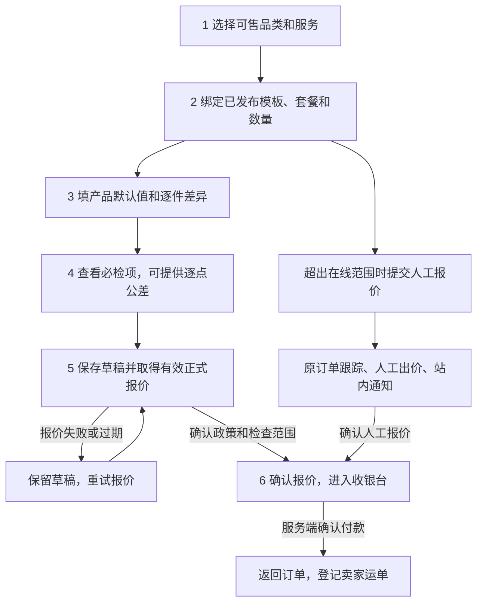

# My Workspace 客户中心整改报告

2026-11-11 至 2026-11-12 · 基线 `34d66aa` · 续做基线 `f972f2b` · 本地工程验收

本轮续接已有七个未提交文件中的客户工作台改动。原 `.env` 指向的开发库和测试库共用一个已经不存在的本地 socket。验证改用本机 PostgreSQL 的独立数据库，分别执行空库关系校验、全量集成及 Chrome。目录、仓址、凭证、运单、图片、支付和角色账号均为隔离夹具。测试未触发外部实物操作或真实交易。

## 实际路由与页面审查

| 模块 | 代码确认的客户入口 | 实际数据与操作 | 验收边界 |
| --- | --- | --- | --- |
| 工作台 | `/account` | PostgreSQL 汇总未结订单、包裹入仓、待处置实物和待确认报价。显示最多三项实际待办、当前默认仓址、永久码、最近订单和五条活动 | 已生效的默认仓址切换为旧账户显示审计时间和新地址提示。真实业务仓址 OPEN |
| 下单 | `/orders/new`，支持 `offer` 和 `draft` 深链 | 主侧栏、单一六步进度、单一摘要。目录联动、已发布模板、逐件默认值与覆盖、草稿与真实报价 | 正式数量档交期、线上未发布组合、未配置附加检查 OPEN |
| 订单列表 | `/orders` | 服务端按订单号、状态、页码查询。按最新记录排序，显示逐件数量、质检状态、付款、报告及下一步。浏览器后退恢复筛选 | 以订单级状态汇总，逐件状态在详情 |
| 订单详情 | `/orders/{publicNo}`，子页 `/payment`、`/parcels`、`/dispositions`、`/storage` | 展示创建、付款、到齐、报告发布、结案等已记录时间。原单支付恢复、实际到仓、范围、售后和逐件处置 | 暂停及异常按实际工单和状态展示，特定短少恢复见 E2E-04 |
| 订单履约详情 | `/orders/{publicNo}/quotes/{id}`、`/orders/{publicNo}/shipments/{id}`、`/orders/{publicNo}/cases/{id}` | 报价版本、仓库交接、运单和工单使用原单与对象双重约束 | 有效正式运输价格及提供方联调 OPEN |
| 待办 | `/actions` | 草稿、待支付、卖家追踪、人工报价确认与过期续询、待选处置、物流验证、范围修订、参考样、续存及客户待回复工单有深链 | 泛化暂停不再单独计作客户待办。人工收件归属审核期间不暴露未匹配仓库对象 |
| 报告 | `/reports`、`/orders/{publicNo}/report`、`/orders/{publicNo}/report/versions/{n}` | 默认最新已发布，支持精确检索和查看历史。PDF 请求锁定同一版本。报告实物编号直达客户库存 | 公开分享沿用原开关，发布快照和私有证据隔离保留 |
| 包裹 | `/parcels`、`/parcels/{id}`、`/shipments/{id}` | 登记运单、绑定本人订单、入仓与承运商状态分列、认领指定运单、出库追踪。列表按 Incoming、Received、Needs Attention、Outgoing 切换 | 通过已关联订单的逐件运单读取供应商和预计件数，与仓库记录数量分列。独立包裹的供应商和件数申报、原始外箱照发布规则 OPEN |
| 实物 | `/items`，实物使用 `?item={code}` 打开抽屉，兼容 `#item-{code}` | 实物编号、所属委托、检查与保管状态。按实物提交不同去向，支持退商家、集运、续存和确认样。待封存状态独立展示 | 每页 20 件，统计与筛选来自全部本人库存。选择跨页保留，提交后回读真实逐件指令 |
| 账单 | `/account/billing`，兼容 `/billing`，用 `?charge={id}` 定位具体收费 | 分开待确认报价、收费和退款。按入账或报价接受时间展示，区分测试付款。订单、待办或通知可直接定位本人历史收费。退货、发运和续存收费显示其关联订单 | Stripe 沙盒及正式主体收据验收 OPEN |
| 通知 | `/account/notifications`，兼容 `/notifications` | 所属对象深链，已读写回，未读计数、游标分页。付款、入库、报告和封存使用现有事件去重键 | 邮件与实际承运商事件联调 OPEN |
| 支持 | `/support`、`/support/cases/{id}` | 创建真实工单、显示工单号、历史及公开对话、客户回复及证据附件。内部备注经过服务端过滤 | 可从本人包裹进入工单，创建时附照片，客户与授权客服可查看。客户自行关闭或重新开启 NEEDS_BUSINESS_DECISION |
| 账户安全 | `/account/security` | 邮箱、登录方式、设备、敏感操作重新认证、导出与账户关闭。永久码显示于账户与安全页面 | 可编辑昵称与显示时区，服务端验证并应用于工作台日期。语言与通知偏好未有对应设置工作流 |
| 测试收银台 | `/checkout/demo/{id}` | 隔离模式确认真实数据库收费记录。付款后回到原检验订单。客户隔离与重复确认由服务端验证 | Stripe 沙盒及正式验收 OPEN |

公开恢复入口为 `/account/recovery`，登录、注册和 onboarding 沿用现有路由。外部分享 `/r/{token}` 不列入客户主导航。路由清单来自 `packages/core/portal-routes.ts` 与 `app/portal.tsx`。

## 六步工作流

报价快照锁定订单行、Offer、SKU 价格版本、模板版本、数量、金额、币种和有效期。交期使用对应目录规则和正式报价明细，并在实物到齐、已识别后按既有营业日规则计时。改动已审阅的内容会使界面不再显示旧报价，重复请求使用幂等键。向导在合法输入后自动保存，步骤切换、手动保存和带草稿号刷新均访问服务端草稿。逐件位置在付款后独立生成，填写运单没有仓库实收效力。

## 根因与变更

| 问题 | 可复核证据 | 整改 |
| --- | --- | --- |
| 404 后停在报价计算 | HEAD 创建草稿得到 `id`，向导读取了 `created.order_id`，随后 GET `/api/v1/orders/undefined`。真正报价为 `POST /api/v1/orders/{id}/quotes`，接收 `revision`，需客户会话、同源 CSRF 及幂等键，成功返回 201。编辑时备注字段亦与 OpenAPI 有差异 | 从创建或编辑 DTO 直接取得 ID 和 revision，省去中间 GET。新建省略空备注，PATCH 支持保留和清空。报价超时、HTTP 错误和过期分别反馈，Retry 继续同一草稿。正式报价失败的 Review 不展示旧估价 |
| 服装检查点混用 | 通用演示模板保存基础项目及带 `applies_if` 的专项点。历史客户端直接列 Offer 内容，显示范围没有复用仓库条件。专项 Offer 和三件通用对比的数量条件也不同 | 依据已发布模板元数据绑定，不以 SKU 字符串推断模板。预览与仓库复用条件规则。草稿可附带已审阅模板版本，旧版冲突和专项品类不符被服务器拒绝 |
| 15 mm 自动公差 | HEAD 把输入初始为 15，保存为 `tolerances.dimension_mm`。报告判定读取带检查点、最小值、最大值和单位的数组。旧字段并未提供有效逐点判定 | 默认只记录实测。逐点填写目标值和公差，单位沿用模板。已发布报告和历史订单原值不变 |
| 双六步导航和摘要操作拥挤 | HEAD 同时有 New Inspection 专属侧栏和正文进度组件。HEAD 源码可确认摘要、页头、报价区存在重叠操作语义。历史截图的第二份摘要实例没有独立部署证据 | 删除向导侧栏及跨组件步骤事件。统一步骤编号，保留唯一摘要与保存入口，重置需确认。Chrome 断言唯一进度和摘要 |
| 共享页头和窄表格 | 初次 Chrome 矩阵测到演示页头把退出按钮挤出视口，通知和账单内容在手机出现严重断词 | 调整客户页头断点，保留账户退出和移动导航。客户密集表格以字段卡片显示。报告比较表保留可横向滚动的列 |
| 出库批次运单入口失效 | 客户批次读取返回运单字符串和扁平报价字段，组件将其当成带 ID 的对象和嵌套报价。Chrome 暴露出缺失 React key，按钮也拿不到运单对象 | 服务端增加已交接运单 ID 与号码，保留原字段兼容。列表用正确的报价字段，运单打开真实客户物流详情 |
| 确认短少后无法恢复 | 库存短少写入 `quantity_discrepancy`，原恢复接口只清除员工暂停。仓库候选和绑定也排除了短少暂停单 | 只对等待收货时因短少冻结的订单开放补件核验绑定。相关短少工单结案、所有范围内实物已经识别且其他冻结已解除后，员工可在原恢复入口排队。保留审计记录，范围、数量和原收费快照不变 |

| 续做事项 | 根因与修复 | 证据 |
| --- | --- | --- |
| 浏览器中断 | 原实现只恢复已成功写入的内容。当前标签页按客户和草稿暂存输入，服务端写入仍使用原草稿版本和幂等守卫。创建响应丢失后先重放原请求，再把后续编辑写到同一草稿 | Chrome 断网刷新、真实创建丢响应、两标签页竞争及数据库唯一草稿断言 |
| 账单收据 | 账单原来仅有处理商引用。新增按收费项读取的会话鉴权入口，逐笔核对入账、组织、付款与渠道对象。正式链接按需读取 | 已签名测试回调写入数据库，隔离渠道响应验证正常链接、错误组织/金额/URL 和跨租户、未付款访问 |
| 账单日期与原单定位 | 原列表按随机收费 ID 截取最近 200 条，旧通知可能找不到相应账目。现按业务日期倒序，指定收费仅在本人记录内优先读取。续存从报价接受时的实物关联查找原订单，退款沿用收费原单 | 用 205 条历史收费核对顺序、旧链接与另一客户的不可见性；在 Chrome 核对从付款页跳转和准确焦点 |
| 窄屏卡片文字 | 375 px 实拍发现付款状态和长实物编号在卡片内被截断，即使整页宽度正常。客户状态和编号现在可在各自单元格内换行 | 复核 375 px 原图；Chrome 在移动截图同时检查状态和编号的文本边界，比较报告保留可滚动对照表 |
| 大批量实物 | 原列表以已加载记录计算数量并截断。按本人库存分页查询并计算总量，以实物码授权打开报告关联物品 | 30 件跨两页分布、状态过滤、确认样及跨租户隔离。Chrome 两页选择提交真实续存指令 |
| 客户支持 | 原包裹和工单分开，首条消息无法提交证据。工单现在可带已授权入库运单和首条私有照片 | Chrome 从真实包裹提单与查看关联，真实工单/照片数据库记录和跨租户拦截 |
| 资料和地址 | 显示时区原来无写入端。客户设置持久化到现有用户字段，登录方式、邮箱和接收码照常使用。地址提示由真正的默认地址变更审计产生 | Chrome 保存与重开资料、订单日期显示。数据库核验过往包裹地址快照、换址、重复设置和新注册账户 |
| 人工报价续询 | 原报价过期后旧申请仍挡住续询，超量订单接受报价后也不能用自动报价恢复。现可在原草稿或未付款原单续询，待办、账单、员工队列和通知按当前可用报价更新 | 隔离数据库核对过期、处理中付款守卫、旧收费金额留档及替换、跨客户隔离。Chrome 验证续询到同单付款 |
| 移动端实物与报告 | 实物抽屉补可访问名称、初始焦点、键盘环绕和返回焦点，只展示客户可读属性。移动报告普通表改为带字段名的记录卡，样品比较保留横向对照表 | Chrome 从后续库存页打开实物、检查焦点，核对现版、历史版 PDF 与移动对比表 |

## 十类端到端回归

结果来自真实隔离数据库及接口。Chrome 报价故障中的 404、422、409、500 和超时通过浏览器网络注入复现，服务端另以真实路由与版本校验重测 404、422、409。通过后续请求取得真实报价并在隔离收银台完成付款。

| 场景 | 结果 | 证据与限制 |
| --- | --- | --- |
| E2E-01 单件样品质检 | 隔离 API 通过 | 单件注册领码、实际 PostgreSQL 订单与收费、入仓、质检、独立复核、PDF 和发运在品类全链用例覆盖。浏览器验证报价到付款回原订单 |
| E2E-02 三家供应商比较 | 隔离 API 通过 | 三件申报具有不同供应商与运单，分别入三个包裹，同一对比报告包含三件，分别申请退货、保管和转运 |
| E2E-03 30 件小批量 | 隔离 API 通过 | 独立 30 件订单完成批量申报、正式目录报价、付款、三包分批收货、30 个独立任务、瑕疵与证据发布及实际转运接口回写 |
| E2E-04 10 件收 8 件 | 隔离 API 通过 | 区分在途与实际短少，待办和工单绑定，客户回复后仍阻止未补齐时恢复。补入两件后经员工恢复并生成十项质检任务 |
| E2E-05 确认样 | 隔离 API 通过 | NEW 四步回归验证待封存、错误铅封拒绝、实物移入参考区、激活、站内通知及后续参考样匹配资格 |
| E2E-06 检后退货 | 隔离 API 通过 | 在同一件实物上断言报告瑕疵标注和私有图像、客户退货授权、报价、付款、打包、承运商交接及原单运单。Chrome 另外验证客户证据与逐件处置入口。实仓交接 OPEN |
| E2E-07 部分转运 | 隔离 API 通过 | 在同一个 30 件订单验证退货、已封存确认样和转运的独立实物状态，核对两个发运批次的各自报价、付款、承运商运单及关联账单 |
| E2E-08 报价失败 | 隔离 Chrome 与 API 通过 | 失败保留服务端草稿，所有错误情况下禁用付款，Retry 返回真实 201，校验模板、价格、金额和有效期。隔离测试复验原单重报、过期报价拒绝返回旧会话链接、重复请求不能拿回缓存链接、创建会话跨过到期时间仍保留渠道记录，以及签名回调入账 |
| E2E-09 数据隔离 | 隔离 Chrome 与 API 通过 | 两个客户，收件码和报价隔离，跨租户报告、PDF、包裹、工单、账单和逐件操作在相应接口被拦截。审核和质检使用各自真实角色会话 |
| E2E-10 浏览器恢复 | 隔离 Chrome 与 API 通过 | 验证步骤刷新、列表前进后退、超时重试、支付双击和重放、会话失效跳转、未保存编辑断网刷新后恢复、服务端已创建但浏览器收不到响应时只建一份草稿、两标签页冲突后保留服务器最新版本并由用户选择是否保存浏览器编辑。跨设备读取已保存草稿沿用服务端版本守卫 |

## 数据与状态联动

| 联动关系 | 隔离数据库与接口断言 |
| --- | --- |
| 客户、订单与收件 | 两个客户的永久码及订单、包裹和工单隔离。换默认仓地址后历史运单地址快照仍指向原址。既有客户显示变更提示，新客户直接取得当前地址。 |
| 订单、报价与账单 | 草稿 revision、正式模板版本、有效 Offer/SKU 价格版本和数量进入同一报价。付款回调同一事件重放后只应用一笔收费。核对业务日期倒序、历史收费深链、续存原单、部分及全额退款、托管收据和租户归属。 |
| 订单、包裹与实物 | 30 件订单按三个运单分别申报、入库与识别。申报供应商和预计件数与仓库记录分开。短少恢复需补齐独立实物、结案并由员工复核。 |
| 实物、质检与报告 | 质检任务接收对应模板版本及范围。报告复核、发布和历史 PDF 按版本读取。报告的实物码打开本人对应库存，跨租户和未发布媒体受服务端授权。 |
| 实物、账单与工单 | 同一订单可按件续存、封存、转运或退货。发运按批次报价和入账，承运商交接后才有实际运单。工单可与本人包裹和私有附件关联，公开回复与内部备注分别验证。 |

## OPEN 与 NEEDS_BUSINESS_DECISION

- **NEEDS_BUSINESS_DECISION** 正式仓址、法律文本、正式类别/套餐、数量档时效与发布审批。当前批准目录与项目约定保持有效。复杂批量继续通过真实人工报价。
- **NEEDS_BUSINESS_DECISION** 客户已离开门户进入 Stripe 收银台时，报价到期如何关闭渠道端会话并处理在途或晚到款。门户已经拒绝发放过期报价的付款链接，涵盖已有会话和同键重放。Stripe 会话创建时可配置的到期时间有 30 分钟下限，渠道端撤销及晚到款处理仍需确认方案并在沙盒验收。[Stripe Checkout Session API](https://docs.stripe.com/api/checkout/sessions/create#create_checkout_session-expires_at)
- **OPEN** 真实 Stripe 沙盒交易及托管收据、正式经营主体配置、Postmark/承运商和实仓硬件。收据链接根据已入账收费及 Stripe 返回的关联 Charge 读取。正式发票按规格 C.7 的 R2 决策跟踪。 [Stripe 托管收据](https://docs.stripe.com/receipts) · [Stripe Charge 对象](https://docs.stripe.com/api/charges/object)
- **NEEDS_BUSINESS_DECISION** 未匹配和已归属包裹的原始外箱照片如何裁剪、复核及发布给客户。现有仓库入库照片含标签及可能的其他运单信息。客户可提交本人的包裹证明，复用工单私有附件。
- **NEEDS_BUSINESS_DECISION** 既有确认样接口的精确库位字段属于 NEW 回归保护范围。新增库存列表与实物抽屉使用已裁剪的客户字段。若需停发旧字段，应同时更新受保护的调用契约及验收用例。
- **NEEDS_BUSINESS_DECISION** 客户是否可主动关闭或重开工单，以及质检、索赔、退款和认领关联工单的限制。现有规则由授权客服结案，客户在开放工单内回复。
- **OPEN** 未委托包裹没有独立的供应商或逐件申报字段。已关联订单的预计数据从在范围内的逐件申报读取。全站切换语言与通知偏好无现成客户设置工作流，待确认支持范围。
- **OPEN** 原项目数据库配置经只读连接预检返回 `ENOENT`。恢复项目数据库连接后才能核对正式目录、客户数据及历史草稿。集成和截图使用隔离副本。供应商配置预检也确认 Stripe 沙盒、Postmark 和快递100未配置。
- 续验责任与恢复条件：环境维护方恢复原项目数据库的授权连接；支付、邮件和物流集成负责人在隔离环境配置各自的供应商测试接入；仓库验收人提供可实际扫描、收货和交接的测试单与设备；业务负责人确认正式地址、条款、目录、交期、晚到款、包裹证据发布和工单规则后，按各原 TASK 继续验收。

## 复现与证据

| 命令 | 退出码 | 结果 |
| --- | --- | --- |
| `npm run check` | 0 | TypeScript 检查通过 |
| `npm run build` | 0 | Next.js 生产构建通过 |
| `python3 docs/contracts/check.py` | 0 | 44 个交易操作，174 个 TASK，69 张页面，111 个实施用例，46 个产品门禁 |
| `TEST_DATABASE_URL=postgresql://127.0.0.1/qcw_test-workspace-final npm run test:integration` | 0 | 60/60，含 AUD-001–015、NEW-001–011、人工报价过期续询、过期付款链接与 Stripe 会话恢复、付款回调、账单历史与收据归属、库存与包裹、资料持久化和原有履约全链 |
| `psql -h 127.0.0.1 -d qcw_workspace_contract -v ON_ERROR_STOP=1 -f docs/contracts/verify.sql` | 0 | 迁移 001–008 后在未播种的空库运行，关系断言通过 |
| `QCW_BROWSER_WORKSPACE_ONLY=1 node tests/workspace.browser.mjs` | 0 | 最终 Chrome 复验覆盖 1440、1280、1024、768、390 和 375 px，客户与两种员工角色，33 个页面或状态共 198 张截图，整页横向溢出为 0。核对窄屏编号和状态、新客户八个模块的真实空状态、收费焦点及隔离 |
| `QCW_BROWSER_RECOVERY_ONLY=1 node tests/workspace.browser.mjs` | 0 | 创建响应丢失后重放、断网刷新、恢复联网后服务端保存、双标签页冲突和人工确认后保存。分别断言离线无写入、重连后写入和禁止覆盖较新版本 |
| `QCW_BROWSER_NEW_CUSTOMER_ONLY=1 node tests/workspace.browser.mjs` | 0 | Checkout 修复后复跑新客户、报价、付款和重放，六种宽度共 36 张截图，整页横向溢出为 0 |
| `QCW_BROWSER_MANUAL_QUOTE_ONLY=1 node tests/workspace.browser.mjs` | 0 | 草稿及原单付款的人工报价过期、员工队列、账单回原单确认并付款。六种宽度共 18 张截图，整页横向溢出为 0 |
| `npm run integrations:check` | 0 | 本机配置预检。Stripe、Postmark、快递100尚无可用的沙盒配置 |

本机 Chrome 截图原图、视口断言与索引随验收包 `qcw-workspace-delivery-screenshots-2026-11-12.zip` 交付。验收包含 `browser.log` 和 `draft-recovery.log`；独立续询日志为 `qcw-workspace-manual-renewal-browser.log`，最后一次集成、构建和关系校验日志为 `qcw-workspace-billing-integration.log`、`qcw-workspace-billing-build.log` 和 `qcw-workspace-billing-relations.log`。日志和截图未纳入代码仓库。

运行 Chrome 测试时在隔离演示实例设置 `QCW_BROWSER_URL` 与 `QCW_BROWSER_EVIDENCE`。Playwright 可安装到临时目录，并以 `QCW_PLAYWRIGHT_MODULE` 指向它的入口。`QCW_BROWSER_FIXTURE_EMAIL` 使用集成库中有已发布报告、历史版本、入仓、出库和工单的 `@qcw.test` 账号，以保存非空页面。`QCW_BROWSER_INVENTORY_EMAIL` 使用至少 21 件待指示实物的夹具账号。跨页回归会为两件实物创建真实测试续存指令，请在独立数据库副本运行。`QCW_BROWSER_COMPARISON_EMAIL` 使用已有发布对比报告的客户夹具。脚本会为新客户走 OTP 和注册，现有隔离角色可用开发环境登录签发真实会话。

验收状态及回退见 [开发排期与任务台账](开发排期与任务台账.md)。提交号可用 `git log -1 -- docs/My-Workspace整改报告.md` 核对。
